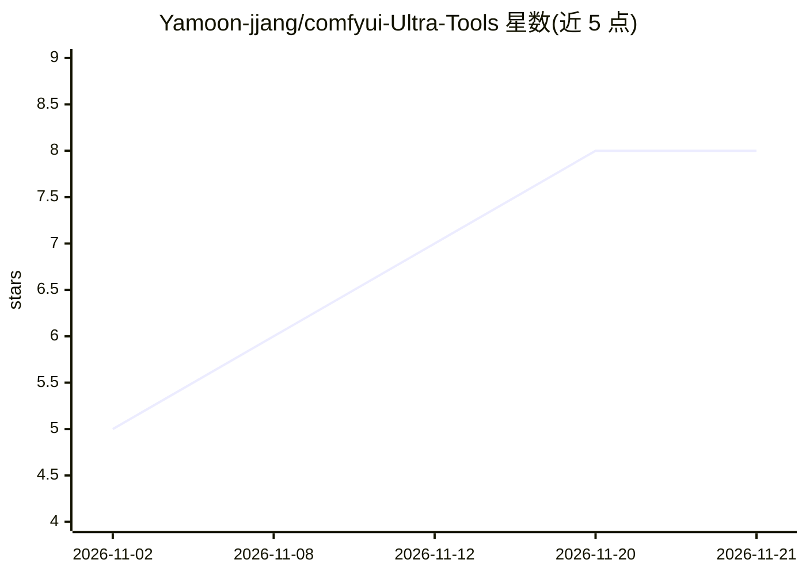

# Yamoon-jjang/comfyui-Ultra-Tools

⭐ 8 · Python · GPL-3.0 · 推送 2026-11-17 · [GitHub](https://github.com/Yamoon-jjang/comfyui-Ultra-Tools) · 个人维护

**给 ComfyUI 用户的 12 个实用自定义节点合集**

面向 ComfyUI 的自定义节点整合包（v2.0.9，12 种节点），覆盖提示词组装与风格化、工作流内翻译、图像加载浏览、文字/图片水印、模型文件查看、音频淡入淡出与执行时间统计等重复性操作。节点功能相互独立、按需连接；界面按 ComfyUI 语言设置自动切换韩/英文；不要求额外 pip 安装，仅使用 ComfyUI 自带库。v2.0.0 起图像生成与 PixelDiD 放大节点被分离为独立包，旧工作流不会自动迁移。提供 git clone、ZIP 手动安装与 ComfyUI Manager（依赖 Registry Active 状态）三种安装途径，GPL v3.0 许可。

## 筛选速览

| 维度 | 判定 | 备注 |
|---|---|---|
| AI 角色 | `ai-ecosystem` | LLM/agent 周边工具 |
| 许可风险 | `viral` | GPL-3.0 |
| 部署形态 | `None` |  |
| 模型依赖 | — | README 未给出锁定关系 |
| 硬件要求 | — | 无带数字的原话,不猜 |
| 安装摩擦 | `low` | 无编译、无系统依赖或容器化 |
| 成熟度 | — | 结构信号不足 |

## 能力要点

- 12 种功能独立的实用节点：提示词组装/风格化、翻译、图像加载、水印、模型查看、计时、音频淡入淡出
- Prompt Composer/Styler 支持 9 种模型文法格式、氛围 22 种 × 风格 34 种等菜单化提示词构建
- Translator 无需 API key 即可通过 MyMemory 公共 API 使用，可选 Google Cloud Translation key 本地保存
- 韩/英界面随 ComfyUI 语言设置自动切换，附节点级韩文手册

## 适用场景

- 在 ComfyUI 中通过菜单组合生成符合不同模型文法的场景提示词
- 为生成图片批量添加文字/图片水印保护版权
- 浏览并直接加载 output 文件夹中的图片、扫描磁盘上的模型文件清理空间
- 为生成音频的开头去除爆音并统计工作流执行耗时

## 场景标签

`提示工程` · 领域:Agent 开发

## 证据(README 行号)

> L3: **ComfyUI를 더 편하게 쓰기 위한 12개 실용 커스텀 노드 모음 — v2.0.9.**
> L4: 프롬프트 작성·스타일 조합, 이미지 탐색과 불러오기, 번역, 글자·이미지 워터마크, 모델 용량 확인, 워크플로우 실행 시간 기록, 오디오 페이드 등 자주 반복하는 작업을 간편하게 처리합니다. 기능은 노드별로 
> L6: - ✅ **추가 pip 설치 없음** — ComfyUI에 기본 포함된 라이브러리만 사용합니다.

## 星数曲线

2026-11-02 5 → 2026-11-21 8（+3）

---
*卡片 v1 · prompt 1.4 · 生成 2026-11-20 · 置信度 mid · 依据 README sha `740129d6db68` · [字段定义](../../DATASET.md)*
