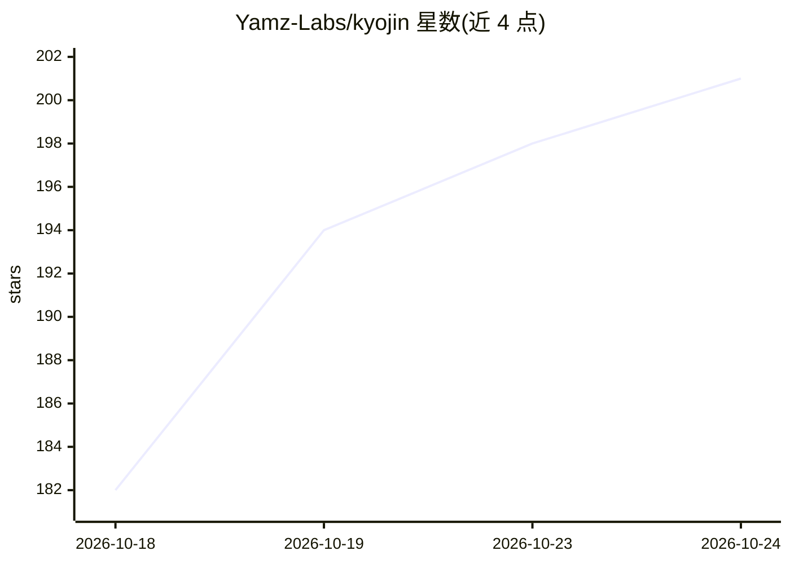

# Yamz-Labs/kyojin

⭐ 205 · Python · MIT · 推送 2026-10-24 · [GitHub](https://github.com/Yamz-Labs/kyojin) · [官网](https://huggingface.co/yamz-labs) · 组织维护

**面向 AMD Strix Halo（ROCm）的 128GB 单机大模型推理引擎**

Yamz 团队开发的推理引擎，基于 ExLlamaV3，针对 AMD Strix Halo（gfx1151/ROCm）优化，在单台 Ryzen AI Max+ 395 128GB 迷你主机上运行 100 GB 级 EXL3 量化 MoE 模型（Qwen/GLM/MiMo），支持投机解码与最长 500K token 上下文。服务器以 OpenAI API 对外提供服务。附带实验性的 DeepSeek-V4.1-Flash（763B）SSD 分层加载方案：权重超过内存时将部分专家保留在 RAM、其余从 NVMe 读取。安装需先装 ROCm torch 并构建，通过 git clone 获取源码、Hugging Face 下载模型包。另提供可选的 uncensored 模式（加载时挂接、不改权重）。

## 筛选速览

| 维度 | 判定 | 备注 |
|---|---|---|
| AI 角色 | `ai-ecosystem` | LLM/agent 周边工具 |
| 许可风险 | `permissive` | MIT |
| 部署形态 | `None` |  |
| 模型依赖 | — | README 未给出锁定关系 |
| 硬件要求 | — | 无带数字的原话,不猜 |
| 安装摩擦 | `low` | 无编译、无系统依赖或容器化 |
| 成熟度 | `idea` | |

## 能力要点

- 在单台 Ryzen AI Max+ 395 128GB 机器上运行 100 GB 级 MoE 模型
- 投机解码：Qwen3.8-Flash-Next 达 47.5-73.2 tokens/s
- 最长 500K token 上下文（含 needle 测试召回验证）
- DeepSeek-V4.1-Flash（763B）实验性 RAM+NVMe SSD 专家分层加载
- 服务器提供 OpenAI API 兼容接口（端口 8000）

## 适用场景

- 在 Strix Halo 128GB 迷你主机上本地部署运行百 GB 级 MoE 模型
- 本地跑长上下文（至 500K）文档问答与召回
- 在单机上体验超大规模（763B）模型的运行演示

## 场景标签

`推理引擎` · 领域:训练与推理

## 证据(README 行号)

> L16:  Tokens per second on one Ryzen AI Max+ 395 with 128 GB. Prefill at the context shown in each cell, speculative dec
> L51: Install ROCm torch and build once (doc/install.md), then:
> L59: The server speaks the OpenAI API on port 8000. GLM and MiMo commands: doc/models.md.

## 星数曲线

2026-10-18 182 → 2026-10-24 201（+19）

---
*卡片 v1 · prompt 1.4 · 生成 2026-10-22 · 置信度 high · 依据 README sha `ef03bf13e7e4` · [字段定义](../../DATASET.md)*
