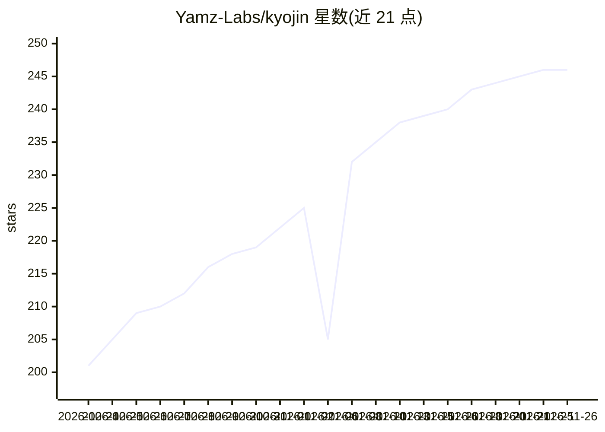

# Yamz-Labs/kyojin

⭐ 246 · Python · MIT · 推送 2026-11-23 · [GitHub](https://github.com/Yamz-Labs/kyojin) · [官网](https://yamzlabs.com) · 组织维护

**让单台桌面机运行百 GB 级开源大模型的推理引擎**

基于 ExLlamaV3 的开源推理引擎，为百 GB 级开源模型（GLM-5.3、Qwen3.8、DeepSeek V4.1 等）提供本地推理服务，覆盖 AMD Strix Halo、NVIDIA RTX 与 Apple Mac 三类硬件路径，每个服务器对外提供 OpenAI 兼容 API 与 tool calling。README 给出各硬件的克隆安装、权重下载与启动命令，附带按上下文长度的实测速度数据与已知限制（如 Strix Halo 需 Linux + ROCm 7.0+、128 GB 内存；NVIDIA 需 sm_80+）。面向想在本地桌面硬件上运行超大开源模型的开发者。

## 筛选速览

| 维度 | 判定 | 备注 |
|---|---|---|
| AI 角色 | `ai-ecosystem` | LLM/agent 周边工具 |
| 许可风险 | `permissive` | MIT |
| 部署形态 | `None` |  |
| 模型依赖 | local-ok | 支持本地模型 |
| 硬件要求 | — | 无带数字的原话,不猜 |
| 安装摩擦 | `medium` | 含编译或系统依赖之一 |
| 成熟度 | — | 结构信号不足 |

## 能力要点

- 基于 ExLlamaV3，服务器提供 OpenAI 兼容 API 与 OpenAI tool-calling API
- 支持 AMD Strix Halo / NVIDIA RTX / Apple Mac 三条硬件路径
- 默认开启推测解码；支持最长 983K tokens 上下文（Mac Studio）
- Qwen3.8-27B 支持图像输入；可选的 uncensored 预设（默认关闭）

## 适用场景

- 在 Strix Halo 128 GB 桌面机上本地运行 100 GB 级模型
- 通过 OpenAI 兼容 API 把本地大模型接入既有应用与 agent 客户端
- 用 tools/bench.sh 自测各上下文长度的推理速度并分享结果

## 场景标签

`推理引擎` · 领域:训练与推理

## 证据(README 行号)

> L3:  Run 100 GB-class AI models on one desktop machine. Open source. OpenAI API. Built on ExLlamaV3.
> L78: Every server speaks the OpenAI API. More commands: doc/models.md.
> L166: - Strix Halo needs Linux (Ubuntu/Debian tested), a gfx1151 machine with 128 GB and ROCm 7.0 or newer; ROCm 6.4 has

## 星数曲线

2026-10-24 201 → 2026-11-26 246（+45）

---
*卡片 v1 · prompt 1.4 · 生成 2026-11-25 · 置信度 high · 依据 README sha `7c69d9aa9f39` · [字段定义](../../DATASET.md)*
