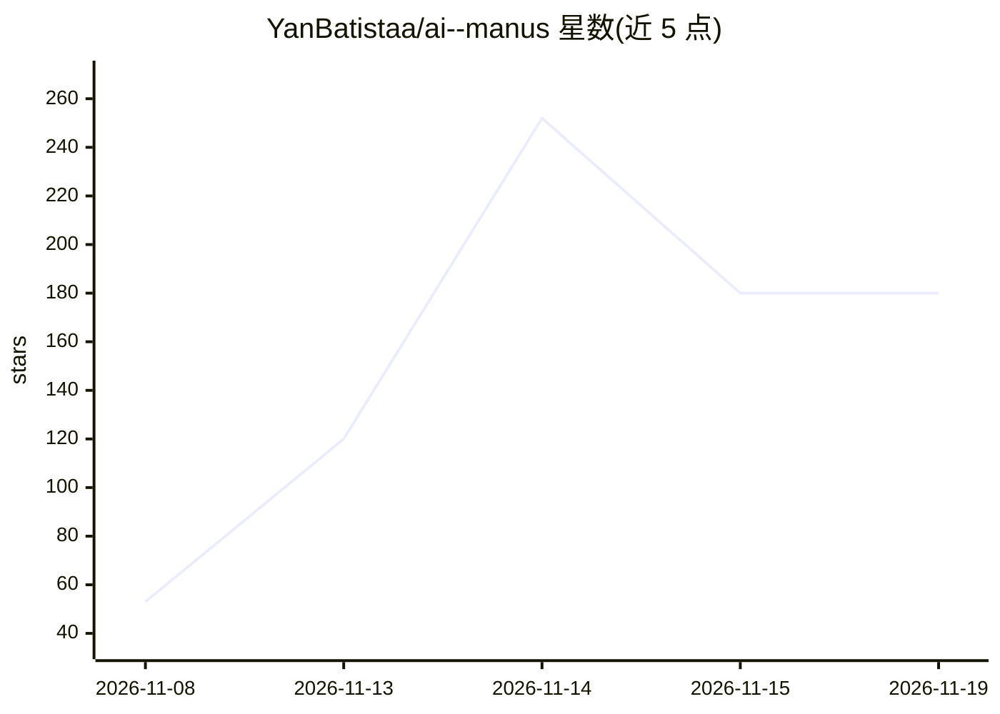

# YanBatistaa/ai--manus

⭐ 180 · Apache-2.0 · 推送 2026-11-18 · [GitHub](https://github.com/YanBatistaa/ai--manus) · 组织维护

**面向个人用户的自主 AI Agent，代执行代码与浏览器任务**

一个自主运行的通用 AI Agent 产品：描述需求后由代理自行编写并执行脚本、操作浏览器（导航网页、填写表单、采集信息），可跨多步骤完成任务并在会话间沿用已建立的工作流。定位为家庭、学习与轻量办公场景的助手，非企业级平台。面向学生、远程工作者等非开发者用户，降低脚本使用门槛。README 仅提供下载入口与兼容性表（64 位系统、4GB 起内存），未给出源码或开发者安装方式。

## 筛选速览

| 维度 | 判定 | 备注 |
|---|---|---|
| AI 角色 | `ai-native` | 本体是模型或模型工具 |
| 许可风险 | `permissive` | Apache-2.0 |
| 部署形态 | `None` |  |
| 模型依赖 | — | README 未给出锁定关系 |
| 硬件要求 | — | 无带数字的原话,不猜 |
| 安装摩擦 | `low` | 无编译、无系统依赖或容器化 |
| 成熟度 | — | 结构信号不足 |

## 能力要点

- 自主执行代码完成多步骤任务
- 浏览器控制：导航网页、填写表单、采集信息
- 会话间保持任务模式的一致性
- 提供系统/CPU/内存最低配置要求

## 适用场景

- 整理研究资料并运行小型计算脚本
- 从多个网页自动采集信息
- 自动化填写重复表单等日常琐事
- 远程技术支持时按步骤检查系统页面

## 场景标签

`AI 助手` `浏览器自动化` `编码 Agent` · 领域:效率与自动化

## 证据(README 行号)

> L18: Manus is an autonomous AI agent designed to run code and control a browser on your behalf. Instead of acting like a
> L22: Manus is not a heavy studio suite or a complex enterprise platform. It is a focused helper built for home, study, a
> L41: |**Memory (RAM)**|4 GB|8 GB or more for heavy Manus autonomous tasks|

## 星数曲线

2026-11-08 53 → 2026-11-19 180（+127）

---
*卡片 v1 · prompt 1.4 · 生成 2026-11-19 · 置信度 mid · 依据 README sha `fe52f87302d9` · [字段定义](../../DATASET.md)*
