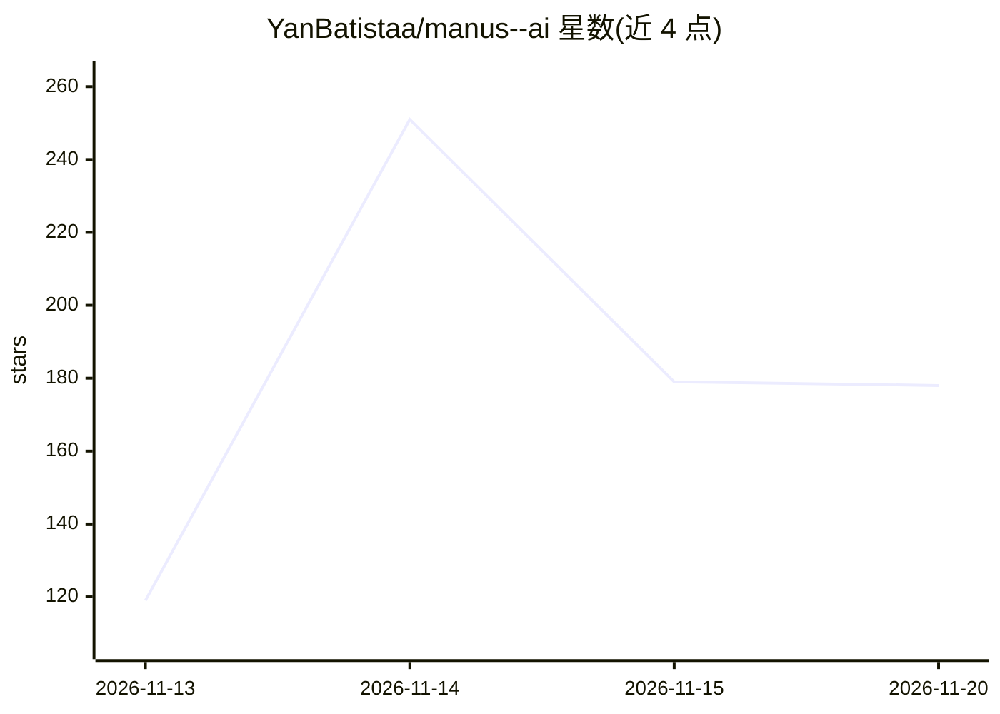

# YanBatistaa/manus--ai

⭐ — · [GitHub]() · 个人维护

**面向个人用户的自主 AI Agent：代用户执行代码与浏览器操作**

一个自主运行的通用 AI Agent，可代用户编写并执行脚本、控制浏览器（导航网页、填写表单、采集信息），执行多步任务并跨会话保持任务模式。定位为家庭、学习与轻量办公的助手，而非企业平台。README 以使用说明与适用场景为主，无源码构建或依赖安装说明；提供下载入口与 6 步上手流程（准备、配置、测试、调整、应用、维护），并给出最低 4 GB 内存、双核 CPU 的兼容性要求。

## 筛选速览

| 维度 | 判定 | 备注 |
|---|---|---|
| AI 角色 | `ai-native` | 本体是模型或模型工具 |
| 许可风险 | `permissive` | — |
| 部署形态 | `None` |  |
| 模型依赖 | — | README 未给出锁定关系 |
| 硬件要求 | — | 无带数字的原话,不猜 |
| 安装摩擦 | `low` | 无编译、无系统依赖或容器化 |
| 成熟度 | — | 结构信号不足 |

## 能力要点

- 自主执行代码完成任务的 agent
- 浏览器控制：导航网页、填表、采集信息
- 多步自主任务与跨会话任务模式保持
- 提供最低系统兼容性表（4 GB 内存/双核 CPU）

## 适用场景

- 让学生整理研究笔记、跑快速计算
- 远程办公时从多个网页采集信息
- 把重复的填表、查页等小事交给 agent 代办
- 开发测试中快速跑脚本实验而不用搭完整环境

## 场景标签

`AI 助手` `浏览器自动化` `编码 Agent` · 领域:效率与自动化

## 证据(README 行号)

> L18: Manus is an autonomous AI agent designed to run code and control a browser on your behalf. Instead of acting like a
> L35: ## Compatibility

## 星数曲线

2026-11-13 119 → 2026-11-20 178（+59）

---
*卡片 v1 · prompt 1.4 · 生成 2026-11-20 · 置信度 mid · 依据 README sha `7aaf6e29bb56` · [字段定义](../../DATASET.md)*
