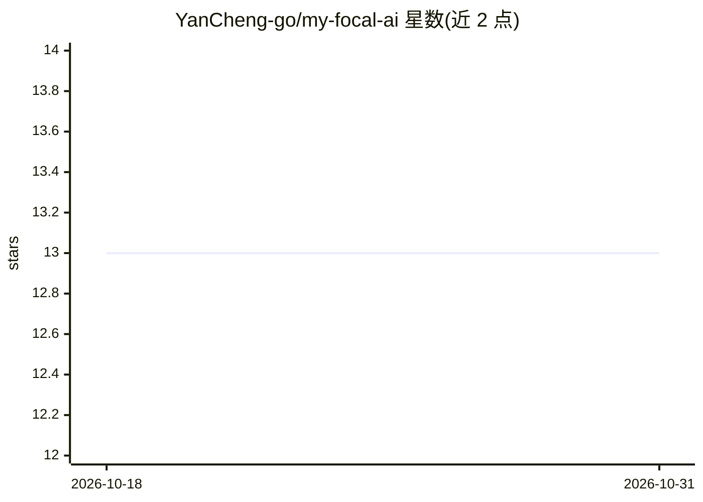

# YanCheng-go/my-focal-ai

⭐ 13 · Python · NOASSERTION · 推送 2026-10-30 · [GitHub](https://github.com/YanCheng-go/my-focal-ai) · [官网](https://myfocalai.vercel.app) · 个人维护

**个人 AI 资讯聚合系统：多源采集、LLM 评分、自托管看板**

从 RSS、YouTube、Twitter、arXiv、活动、GitHub trending、AI 工具趋势、agent 技能等精选来源聚合 AI 内容，用 LLM 对相关性评分，并通过 FastAPI 网页面板展示。支持三种部署模式：本地 SQLite + Ollama + FastAPI 全功能运行；Vercel + GitHub Actions 静态只读看板；Supabase + Vercel 带账号与按需抓取。快速启动依赖 uv 和 Docker，运行 start.sh 一键安装依赖并启动服务，可选跳过 LLM 评分仅做抓取展示。许可证为 CC BY-NC 4.0。

## 筛选速览

| 维度 | 判定 | 备注 |
|---|---|---|
| AI 角色 | `ai-native` | 本体是模型或模型工具 |
| 许可风险 | `none` | NOASSERTION |
| 部署形态 | `None` |  |
| 模型依赖 | local-ok | 支持本地模型 |
| 硬件要求 | — | 无带数字的原话,不猜 |
| 安装摩擦 | `low` | 无编译、无系统依赖或容器化 |
| 成熟度 | — | 结构信号不足 |

## 能力要点

- 聚合 RSS/YouTube/Twitter/arXiv/GitHub trending 等 8 类来源
- LLM 相关性评分，本地 Ollama 免费、在线可用 Claude API
- 三种部署模式：本地全功能/静态公开/带账号登录
- start.sh 一键启动（安装依赖、启动 RSSHub + Ollama、打开看板）

## 适用场景

- 搭建个人 AI 领域资讯看板，跟踪多源内容
- 本地免 API 费用地跑通聚合与 LLM 评分
- 部署到 Vercel 生成公开只读或带账号的资讯站

## 场景标签

`网页抓取` · 领域:效率与自动化

## 证据(README 行号)

> L8: Personal news intelligence system that aggregates AI content from curated sources (RSS, YouTube, Twitter, arXiv, eve
> L35: |**Local**|SQLite + Ollama + FastAPI|Full-featured, runs on your machine|

## 星数曲线

2026-10-18 13 → 2026-10-31 13（+0）

---
*卡片 v1 · prompt 1.4 · 生成 2026-10-31 · 置信度 high · 依据 README sha `cdbb71eb171d` · [字段定义](../../DATASET.md)*
