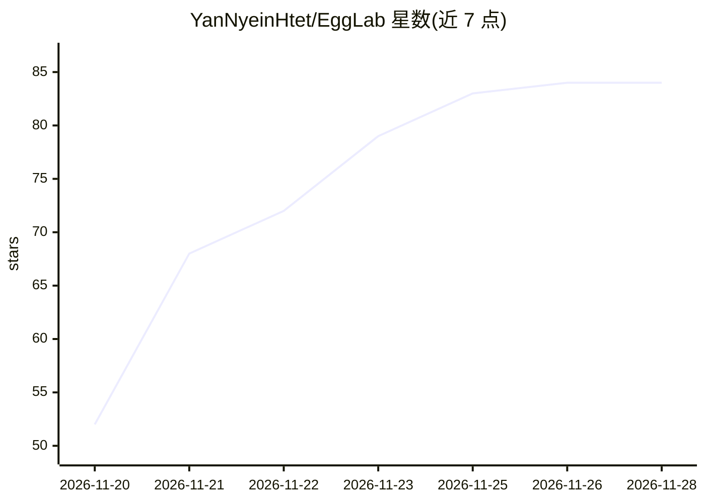

# YanNyeinHtet/EggLab

⭐ 84 · JavaScript · MIT · 推送 2026-11-27 · [GitHub](https://github.com/YanNyeinHtet/EggLab) · [官网](https://github.com/YanNyeinHtet/EggLab/releases/latest) · 个人维护

**Windows 本地 AI 图像生成编辑客户端：驱动 PhotoCraft 画布的设计代理**

基于 Electron 的 Windows 桌面应用，通过 stable-diffusion.cpp 在本地 GPU 上运行 Qwen-Image-2.1，提供图像生成（40 步质量/8 步 turbo LoRA，最高 2048 px）、参考图编辑、透明抠图等能力。内嵌知道 PhotoCraft（图层/蒙版/文本/导出）的设计代理，经 OpenCode 运行时驱动，聊天结果可直接作为图层放入 PhotoCraft 画布。模型与渲染留在本地，仅聊天文本发送到所选模型提供方。安装器未签名（SmartScreen 会提示），开发构建需 Node 20+。

## 筛选速览

| 维度 | 判定 | 备注 |
|---|---|---|
| AI 角色 | `ai-native` | 本体是模型或模型工具 |
| 许可风险 | `permissive` | MIT |
| 部署形态 | `desktop` | 安装包/桌面程序 |
| 模型依赖 | — | README 未给出锁定关系 |
| 硬件要求 | — | 无带数字的原话,不猜 |
| 安装摩擦 | `medium` | 含编译或系统依赖之一 |
| 成熟度 | — | 结构信号不足 |

## 能力要点

- 本地 GPU 推理：Qwen-Image-2.1 跑在 stable-diffusion.cpp，无需 ComfyUI/Python/云渲染
- 设计代理了解 PhotoCraft 的图层、蒙版、文本与导出，结果直接落到画布
- 聊天按文档分组隔离，每个 PhotoCraft 文档保留独立会话
- 三种模型变体（Uncensored FP8 / Official Q4_K_M Beta / Uncensored Q5_K_M）可切换

## 适用场景

- 在本地 GPU 上生成和编辑图像，不上传云端
- 让 AI 代理把生成图作为图层放进 PhotoCraft 画布
- 按文档管理多轮设计对话与生成图记录

## 场景标签

`图像生成` · 领域:内容生成

## 证据(README 行号)

> L3: **Local AI image generation and editing for Windows.** A floating egg opens a design agent
> L6: Everything runs on your own GPU: Qwen-Image-2.1 on
> L7: stable-diffusion.cpp. No ComfyUI, no

## 星数曲线

2026-11-20 52 → 2026-11-28 84（+32）

---
*卡片 v1 · prompt 1.4 · 生成 2026-11-20 · 置信度 high · 依据 README sha `1ced8523d59b` · [字段定义](../../DATASET.md)*
