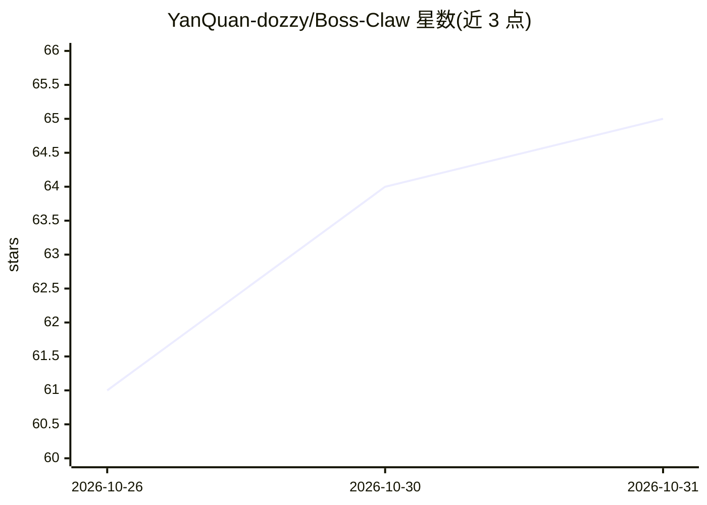

# YanQuan-dozzy/Boss-Claw

⭐ 65 · TypeScript · Apache-2.0 · 推送 2026-10-30 · [GitHub](https://github.com/YanQuan-dozzy/Boss-Claw) · [官网](https://github.com/YanQuan-dozzy/Boss-Claw/releases/latest) · 个人维护 · 中文 README

**本地 AI 求职助手：四平台岗位采集、AI 匹配排序与投递管理**

Electron 桌面应用，面向在 BOSS直聘/猎聘/智联/前程无忧投递的求职者：本地解析简历（5 种格式）、AI 生成职业画像与岗位四层匹配评分、按岗位定制简历、生成招呼语，投递节奏分人工确认/半自动/自动辅助/自动沟通四档，发送前需人确认并带配额与风控中止机制。另含模拟面试（含本地语音朗读/转写/题库 BM25 召回，标注未完整测试）、SKILL.md 技能体系与外部 Agent 经 MCP/控制桥接入。API Key 存本机，简历解析与岗位过滤均在本地执行。

## 筛选速览

| 维度 | 判定 | 备注 |
|---|---|---|
| AI 角色 | `ai-native` | 本体是模型或模型工具 |
| 许可风险 | `permissive` | Apache-2.0 |
| 部署形态 | `desktop` | 安装包/桌面程序 |
| 模型依赖 | locked-api |  |
| 硬件要求 | — | 无带数字的原话,不猜 |
| 安装摩擦 | `low` | 无编译、无系统依赖或容器化 |
| 成熟度 | `idea` | |

## 能力要点

- 4 个招聘平台的采集→匹配→排序→沟通→投递全链路
- 本地解析 PDF/DOCX/DOC/MD/TXT 简历，原文不出机器
- AI 四层裁决匹配评分（fitLevel 档位）+ 定制简历与招呼语生成
- 零依赖 MCP 服务器（9 工具/3 组）与控制桥供外部 Agent 接入

## 适用场景

- 多平台投递时集中管理岗位筛选、沟通草稿与投递进度
- 用自己的 API Key 做岗位匹配与简历定制，数据留在本机
- 拿到面试后按目标 JD 做模拟面试练习
- 让 Claude/Cursor 等外部 Agent 经 MCP 驱动本机投递工具

## 场景标签

`AI 助手` `浏览器自动化` · 领域:效率与自动化

## 证据(README 行号)

> L3: **面向求职者的本地 AI 投递助手（Electron 桌面应用）**
> L26: 导入简历 → AI 生成职业画像 → 自主选择投递方向 → 整理岗位信息
> L141: AI 生成个性化招呼语（求职者口吻、**≤250 字**）。工作台「一键投递」按岗位平台自动分派通道：BOSS 走详情页真实 DOM 沟通；猎聘 / 智联 / 前程无忧在各自平台标签页内投递。

## 星数曲线

2026-10-26 61 → 2026-10-31 65（+4）

---
*卡片 v1 · prompt 1.4 · 生成 2026-10-27 · 置信度 mid · 依据 README sha `7e4b8819a310` · [字段定义](../../DATASET.md)*
