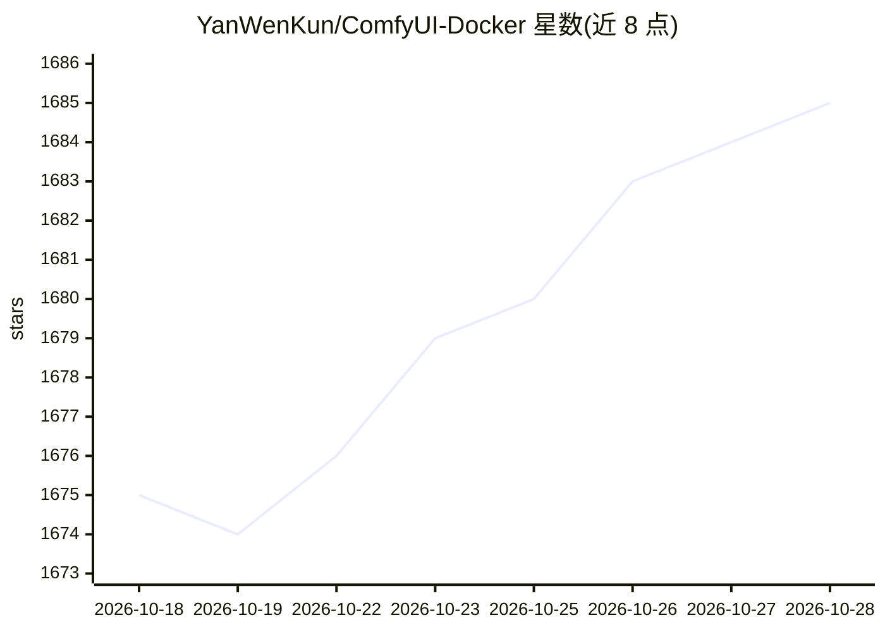

# YanWenKun/ComfyUI-Docker

⭐ 1,685 · Dockerfile · NOASSERTION · 推送 2026-10-27 · [GitHub](https://github.com/YanWenKun/ComfyUI-Docker) · [官网](https://hub.docker.com/r/yanwk/comfyui-boot) · 个人维护 · 中文 README

**ComfyUI 的 Docker 镜像集：覆盖 CUDA/ROCm/XPU/CPU 多后端**

为 ComfyUI（节点式 AIGC 工作流 GUI）提供预构建 Docker 镜像与 Dockerfile，发布于 Docker Hub。按后端分系列：CUDA（slim 仅含 ComfyUI 与 Manager，megapak 附带开发套件与数十个 Custom Node）、AMD ROCm 6/7、Intel XPU、CPU-only，另有 nightly 测试标签与已归档标签。README 以表格列出各 GPU 架构（Blackwell 至 Maxwell）与 CUDA 12.6/13.0/13.2 版本的兼容关系，说明限制来自 PyTorch 工具链。

## 筛选速览

| 维度 | 判定 | 备注 |
|---|---|---|
| AI 角色 | `ai-ecosystem` | LLM/agent 周边工具 |
| 许可风险 | `none` | NOASSERTION |
| 部署形态 | `self-host` | docker 或自建部署 |
| 模型依赖 | — | README 未给出锁定关系 |
| 硬件要求 | `cpu-ok` | |
| 安装摩擦 | `low` | 无编译、无系统依赖或容器化 |
| 成熟度 | — | 结构信号不足 |

## 能力要点

- 覆盖 NVIDIA CUDA / AMD ROCm / Intel XPU / CPU 四类后端的镜像标签
- slim 与 megapak 两种 CUDA 镜像（megapak 含数十个 Custom Node）
- GPU 架构×CUDA 版本兼容性对照表（Blackwell 至 Maxwell）
- 提供 nightly 测试标签与已归档 Dockerfile

## 适用场景

- 在 NVIDIA/AMD/Intel GPU 服务器上以容器方式运行 ComfyUI
- 快速获得带常用 Custom Node 的 ComfyUI 一体化环境
- 在不同 CUDA 版本间选择与显卡架构匹配的镜像

## 场景标签

 · 领域:AIGC/容器化部署

## 证据(README 行号)

> L7: that runs
> L8: https://github.com/Comfy-Org/ComfyUI[ComfyUI] -
> L69: * link:cu130-slim-v2/README.adoc[`cu130-slim-v2`] ⭐

## 星数曲线

2026-10-18 1,675 → 2026-10-28 1,685（+10）

---
*卡片 v1 · prompt 1.4 · 生成 2026-10-21 · 置信度 high · 依据 README sha `72b233852231` · [字段定义](../../DATASET.md)*
