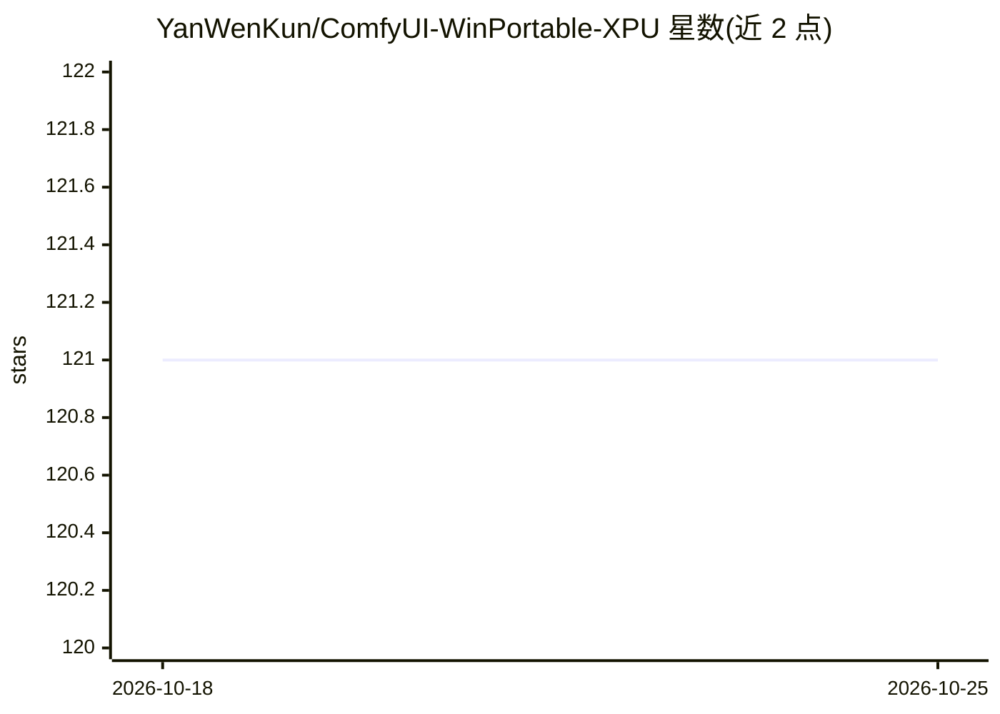

# YanWenKun/ComfyUI-WinPortable-XPU

⭐ 121 · Python · GPL-3.0 · 推送 2026-07-09 · [GitHub](https://github.com/YanWenKun/ComfyUI-WinPortable-XPU) · 个人维护 · 中文 README

**面向英特尔显卡的 ComfyUI Windows 免安装整合包**

基于 ComfyUI-Windows-Portable 派生的 Windows 便携整合包，将 ComfyUI 及其依赖打包为面向 Intel GPU（XPU）的免编译运行环境：预装 40 余个常用自定义节点与 200 余个兼容 Python 包（含 insightface、dlib 等需编译依赖），预下载部分模型文件，提供启动器 bat 与浏览器访问界面。支持 Arc Battlemage/Alchemist、Panther/Lunar/Arrow/Meteor Lake 等显卡（CPU）。用户需自行安装 Intel 显卡驱动与 VC++ 运行库，并自备 SD 模型；README 给出各模型在 Arc B580 上的测试结果与 VRAM 溢出等已知问题。

## 筛选速览

| 维度 | 判定 | 备注 |
|---|---|---|
| AI 角色 | `ai-ecosystem` | LLM/agent 周边工具 |
| 许可风险 | `viral` | GPL-3.0 |
| 部署形态 | `desktop` | 安装包/桌面程序 |
| 模型依赖 | — | README 未给出锁定关系 |
| 硬件要求 | — | 无带数字的原话,不猜 |
| 安装摩擦 | `low` | 无编译、无系统依赖或容器化 |
| 成熟度 | — | 结构信号不足 |

## 能力要点

- 面向 Intel GPU 的免编译 Windows 便携包，含 200+ 预配置 Python 依赖
- 预装 40+ 常用自定义节点（Manager、GGUF、OpenVINO、Impact Pack 等）
- 提供 GitHub CI/CD 构建脚本，fork 仓库即可自制整合包
- HuggingFace/PyTorch 缓存重定向至程序目录，便于管理

## 适用场景

- 在英特尔显卡（Arc/核显）上开箱即用运行 ComfyUI 生成图片
- 避免自行配置 Python 环境与编译 insightface/dlib 等依赖
- 通过替换目录方式对整合包进行大版本更新

## 场景标签

`图像生成` · 领域:内容生成

## 证据(README 行号)

> L8: Similar to the official ComfyUI
> L10: package, but built for Intel GPUs.
> L47: ** Dependencies (200+ compatible Python packages) are pre-configured, including those that require compilation like

## 星数曲线

2026-10-18 121 → 2026-10-25 121（+0）

---
*卡片 v1 · prompt 1.4 · 生成 2026-10-23 · 置信度 high · 依据 README sha `453a9416cb9e` · [字段定义](../../DATASET.md)*
