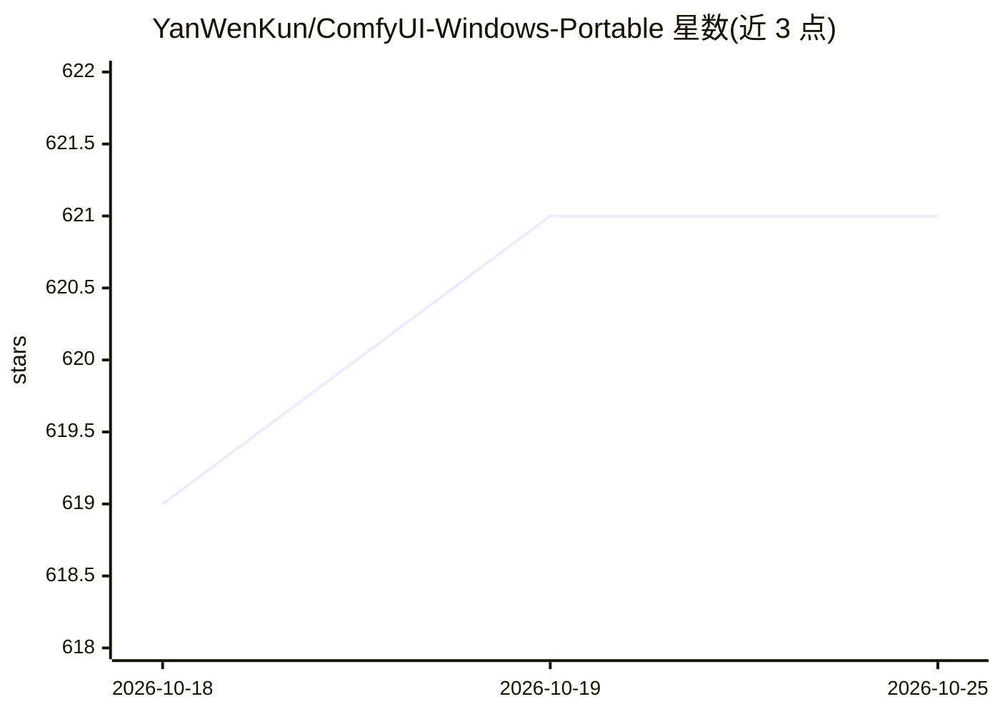

# YanWenKun/ComfyUI-Windows-Portable

⭐ 621 · Python · GPL-3.0 · 推送 2026-10-19 · [GitHub](https://github.com/YanWenKun/ComfyUI-Windows-Portable) · 个人维护 · 中文 README

**ComfyUI 的 Windows 便携整合包：预装 40+ 自定义节点**

面向 Windows 用户的 ComfyUI 便携包，类似官方 standalone portable，但预装 40+ 常用自定义节点与 300+ 相互兼容的 Python 包（含 SageAttention、xFormers 等性能库及 insightface、dlib 等已编译的原生依赖），下载分卷压缩包解压后运行 RUN_Launcher.bat 即可启动。仅支持 NVIDIA GPU（2018 年及以后）；不含 SD 模型文件，需用户自备并放入 models 目录。通过 GitHub Actions 流水线打包，fork 仓库即可自行构建。

## 筛选速览

| 维度 | 判定 | 备注 |
|---|---|---|
| AI 角色 | `ai-ecosystem` | LLM/agent 周边工具 |
| 许可风险 | `viral` | GPL-3.0 |
| 部署形态 | `desktop` | 安装包/桌面程序 |
| 模型依赖 | — | README 未给出锁定关系 |
| 硬件要求 | — | 无带数字的原话,不猜 |
| 安装摩擦 | `low` | 无编译、无系统依赖或容器化 |
| 成熟度 | — | 结构信号不足 |

## 能力要点

- 预装 40+ 常用自定义节点与 300+ 兼容 Python 包，依赖已解决
- 需原生编译的包（insightface、dlib 等）已预先构建
- 通过 GitHub Actions 打包，fork 即可自建整合包
- 重定向 HF Hub 与 PyTorch 下载目录到程序根目录便于管理

## 适用场景

- 在 Windows 上免配置快速运行 ComfyUI
- 避免自行解决节点与 Python 包的兼容和编译问题
- 基于该仓库流水线构建自己的定制整合包

## 场景标签

`图像生成` · 领域:内容生成

## 证据(README 行号)

> L9: https://github.com/Comfy-Org/ComfyUI/releases[ComfyUI official standalone portable],
> L10: but preloaded with numerous custom nodes and Python packages, with all dependencies resolved and ready to use.
> L30: . Only NVIDIA GPUs (2018 or newer) are supported. Installing the latest driver is strongly recommended.

## 星数曲线

2026-10-18 619 → 2026-10-25 621（+2）

---
*卡片 v1 · prompt 1.4 · 生成 2026-10-21 · 置信度 mid · 依据 README sha `935f984e6dc7` · [字段定义](../../DATASET.md)*
