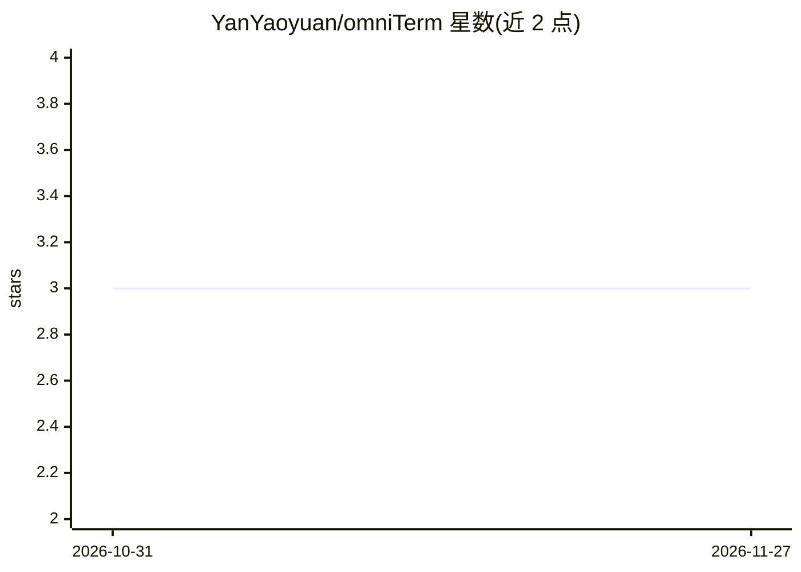

# YanYaoyuan/omniTerm

⭐ 3 · Rust · Apache-2.0 · 推送 2026-11-26 · [GitHub](https://github.com/YanYaoyuan/omniTerm) · 个人维护 · 中文 README

**面向开发者：集成 Codex Agent 的跨平台终端工作台**

Electron 桌面应用，把本地 shell 标签、分屏、SSH、图形化 SFTP 浏览器、串口连接与端口转发合并到一个工作台，支持 macOS/Linux/Windows。核心机制是从本仓库源码构建的 Rust Codex Agent 共享工作区：用户选中终端输出发送给 Agent，执行遵循 Codex 的审批与沙箱配置，本身不捆绑模型权重，模型访问依赖 Codex 的认证与 provider 配置。SSH/SFTP/转发依赖系统 OpenSSH，串口依赖 Python 3 + pyserial。当前为 0.1.0 早期版本。

## 筛选速览

| 维度 | 判定 | 备注 |
|---|---|---|
| AI 角色 | `ai-enhanced` | 去掉 AI 部分产品仍成立 |
| 许可风险 | `permissive` | Apache-2.0 |
| 部署形态 | `None` |  |
| 模型依赖 | — | README 未给出锁定关系 |
| 硬件要求 | — | 无带数字的原话,不猜 |
| 安装摩擦 | `low` | 无编译、无系统依赖或容器化 |
| 成熟度 | `idea` | |

## 能力要点

- 本地源码构建的 Codex Agent 与终端/SSH/SFTP/串口共处同一工作区
- SSH 支持导入 ~/.ssh/config（含 Include）与多级 ProxyJump 跳板
- xterm.js 6 + WebGL 渲染，13 主题、广播输入、命令面板
- 工作区恢复：以新 shell 会话还原标签、分屏与工作目录（最多 16 面板）

## 适用场景

- 在一个桌面应用里管理本地与远程服务器的终端、文件与端口转发
- 选中终端报错后直接让 Codex Agent 分析并代为执行命令
- 通过串口连接设备并配合远程主机监控面板查看指标

## 场景标签

`编码 Agent` · 领域:编码与开发

## 证据(README 行号)

> L11: omniTerm brings shell tabs, split panes, SSH, a graphical SFTP browser, serial connections and port forwarding into
> L32: |Agent collaboration|Terminal-aware Agent with selected context and execution targets, command approval, staging, c
> L48: - SSH/SFTP/forwarding require system OpenSSH. Serial requires Python 3 and `pyserial`. On Windows, the file/metrics

## 星数曲线

2026-10-31 3 → 2026-11-27 3（+0）

---
*卡片 v1 · prompt 1.4 · 生成 2026-11-22 · 置信度 high · 依据 README sha `45582f9cd8c4` · [字段定义](../../DATASET.md)*
