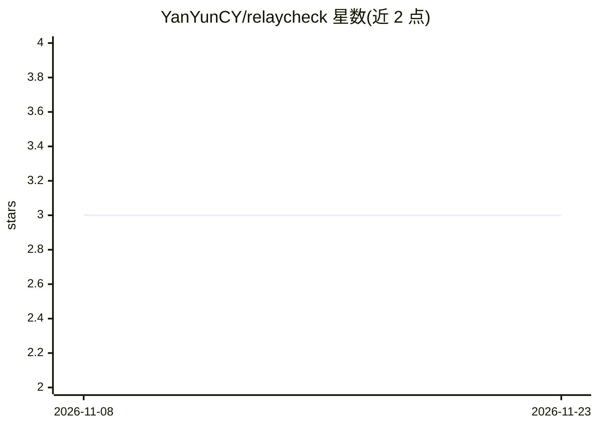

# YanYunCY/relaycheck

⭐ 3 · TypeScript · MIT · 推送 2026-11-07 · [GitHub](https://github.com/YanYunCY/relaycheck) · 个人维护 · 中文 README

**检验 LLM 中转站是否真的在提供所声明模型的 CLI 工具**

relaycheck 是一个 Node.js CLI，通过行为指纹统计检验 LLM API 中转/代理/网关：身份组用 24 个有限选择探针与参考指纹做蒙特卡洛置换 χ² 检验输出 p 值，另含协议（工具调用、SSE、停止序列）、计费（usage 与官方 token 数比对）和上下文（多深度大海捞针）三组检查，支持 Anthropic Messages、OpenAI Chat Completions 与 Responses 协议。密钥只从环境变量读取，无遥测。内置 5 个 OpenAI 系模型参考指纹，Claude 参考需自建。限制：多数时间为真模型的混合中转难以检出。

## 筛选速览

| 维度 | 判定 | 备注 |
|---|---|---|
| AI 角色 | `ai-ecosystem` | LLM/agent 周边工具 |
| 许可风险 | `permissive` | MIT |
| 部署形态 | `library` | 以包/库形式分发 |
| 模型依赖 | locked-api |  |
| 硬件要求 | — | 无带数字的原话,不猜 |
| 安装摩擦 | `low` | 无编译、无系统依赖或容器化 |
| 成熟度 | — | 结构信号不足 |

## 能力要点

- 身份检验：24 探针 × N 采样与参考指纹比对，输出蒙特卡洛置换 χ² p 值
- 四组检查：身份/协议/计费/上下文，--deep 扩展到 100k 上下文测试
- 支持 Anthropic Messages、OpenAI Chat Completions 与 Responses 三种协议（--api auto）
- 输出 JSON/HTML/双语分享卡片，退出码适配 CI 集成

## 适用场景

- 使用第三方中转访问 Claude Code/Codex 前验证是否为真模型
- 检测中转是否注入隐藏系统提示或篡改 token 计费
- 在 CI 中定期监控团队依赖的中转站一致性
- 用官方密钥为其他模型自建参考指纹（约一美元）

## 场景标签

`模型评测` · 领域:评测与运维

## 证据(README 行号)

> L5: Statistically test whether an LLM API relay, proxy or gateway serves the model it claims, bills the tokens it should
> L35: |**Identity**|24 finite-choice probes × N samples at temperature 1 (probe set v2). Each answer distribution is comp
> L40: Speaks Anthropic Messages, OpenAI Chat Completions and OpenAI Responses (`--api auto`).

## 星数曲线

2026-11-08 3 → 2026-11-23 3（+0）

---
*卡片 v1 · prompt 1.4 · 生成 2026-11-22 · 置信度 high · 依据 README sha `9bb069b93b50` · [字段定义](../../DATASET.md)*
