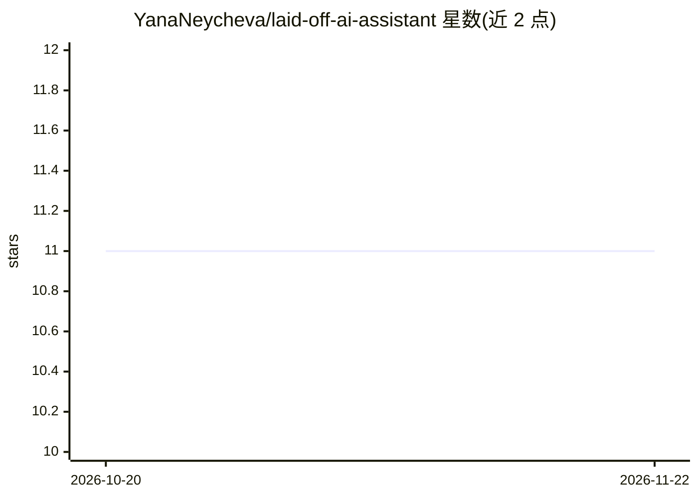

# YanaNeycheva/laid-off-ai-assistant

⭐ 11 · TypeScript · NOASSERTION · 推送 2026-11-20 · [GitHub](https://github.com/YanaNeycheva/laid-off-ai-assistant) · [官网](https://uncoachable.work/) · 个人维护

**面向失业者的保加利亚语求职全程 AI 助手**

以 Claude Code / OpenCode 中运行的 agent 形式提供的对话式助手，覆盖失业救济（保加利亚 НОИ/Бюро по труда 期限与金额计算）、CV 制作与按岗位定制、求职策略、模拟面试、公司调研与情绪支持六个方面。架构为 orchestrator 委派专用 subagent，另有独立的 freshness-checker 对救济/法律类陈述做来源核验。产物（CV .docx/.pdf、dossier、tracker）写入 git-ignored 的 Personal/ 目录。Codex/Copilot 生成的 agent 树为实验性，未经行为测试。

## 筛选速览

| 维度 | 判定 | 备注 |
|---|---|---|
| AI 角色 | `ai-native` | 本体是模型或模型工具 |
| 许可风险 | `none` | NOASSERTION |
| 部署形态 | `None` |  |
| 模型依赖 | — | README 未给出锁定关系 |
| 硬件要求 | — | 无带数字的原话,不猜 |
| 安装摩擦 | `low` | 无编译、无系统依赖或容器化 |
| 成熟度 | — | 结构信号不足 |

## 能力要点

- orchestrator + 专用 subagent 架构（cv-builder、interview-coach、bg-navigator 等）
- freshness-checker 独立核验救济/法律陈述，对照 НОИ/НАП 官方来源
- CV 输出 ATS 友好的 .docx + .pdf，支持保加利亚语与英语
- 可通过 OpenCode 免费运行，无需付费 AI 订阅

## 适用场景

- 失业后计算保加利亚失业救济资格与申请期限
- 从零生成或按具体岗位定制 ATS 友好的简历
- 面试前做模拟面试并打磨离职叙事
- 维护求职申请 tracker 与外联草稿

## 场景标签

`AI 助手` · 领域:对话与助手

## 证据(README 行号)

> L3: An interactive assistant that supports a laid-off professional through the **whole** arc of finding their next job —
> L89: One **orchestrator** is the single voice you talk to. It holds the relationship — the check-in, the steadying layer

## 星数曲线

2026-10-20 11 → 2026-11-22 11（+0）

---
*卡片 v1 · prompt 1.4 · 生成 2026-11-18 · 置信度 high · 依据 README sha `162d5c86dd7a` · [字段定义](../../DATASET.md)*
