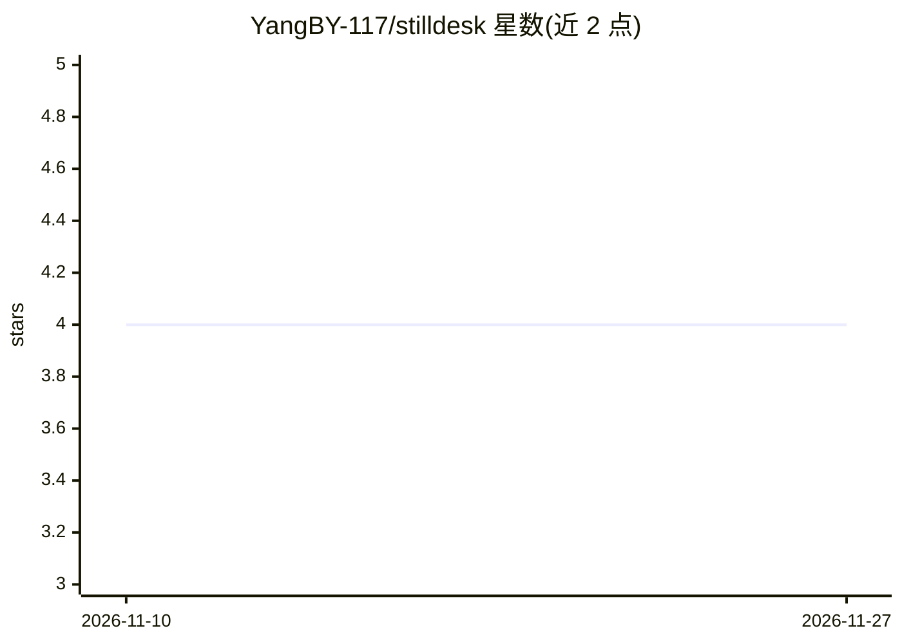

# YangBY-117/stilldesk

⭐ 4 · Python · NOASSERTION · 推送 2026-11-07 · [GitHub](https://github.com/YangBY-117/stilldesk) · [官网](https://yangby-117.github.io/stilldesk/) · 个人维护 · 中文 README

**为 AI agent 提供浏览器与本地应用后台操作的 MCP/CLI 工具**

StillDesk 通过一个 CLI 和一个 MCP server，为运行在用户机器上的 agent 提供针对 Chrome、Edge、微信、QQ、飞书、腾讯会议的后台接口：标签页管理、DOM 快照、表单填写、上传下载、本地历史检索、会议转录读取等。浏览器控制走扩展加 Native Messaging，不使用远程调试端口、CDP、Puppeteer/Playwright 连接或 debugger 权限；不移动物理光标、不注入全局按键。内置无模型提供方，工具只向用户已有 agent 返回结构化观察结果。当前平台为 Windows，README 自述为早期软件，各适配器能力范围不同。

## 筛选速览

| 维度 | 判定 | 备注 |
|---|---|---|
| AI 角色 | `ai-ecosystem` | LLM/agent 周边工具 |
| 许可风险 | `permissive` | NOASSERTION |
| 部署形态 | `None` |  |
| 模型依赖 | — | README 未给出锁定关系 |
| 硬件要求 | — | 无带数字的原话,不猜 |
| 安装摩擦 | `low` | 无编译、无系统依赖或容器化 |
| 成熟度 | `idea` | |

## 能力要点

- 浏览器后台控制：标签页、DOM 快照、表单、上传下载、可见页截图，不占用前台光标
- 不依赖远程调试端口/CDP/Puppeteer/Playwright，通过扩展与 Native Messaging 实现
- 为 Codex、Claude Code、Gemini、Cursor、VS Code、Cline 等客户端生成接入配置
- 微信/QQ 本地历史检索、飞书官方 API 操作、腾讯会议转录读取

## 适用场景

- 让 agent 在后台操作浏览器页面，同时自己继续使用电脑
- 检索微信/QQ 本地聊天历史作为 agent 上下文
- 通过授权的服务 API 让 agent 操作飞书或读取会议转录

## 场景标签

`浏览器自动化` · 领域:效率与自动化

## 证据(README 行号)

> L12: MCP + CLI
> L18: StillDesk gives it app-specific background interfaces through **one CLI and one
> L134: No model provider is built in. The tool returns structured observations to your

## 星数曲线

2026-11-10 4 → 2026-11-27 4（+0）

---
*卡片 v1 · prompt 1.4 · 生成 2026-11-21 · 置信度 high · 依据 README sha `0d3f1e697317` · [字段定义](../../DATASET.md)*
