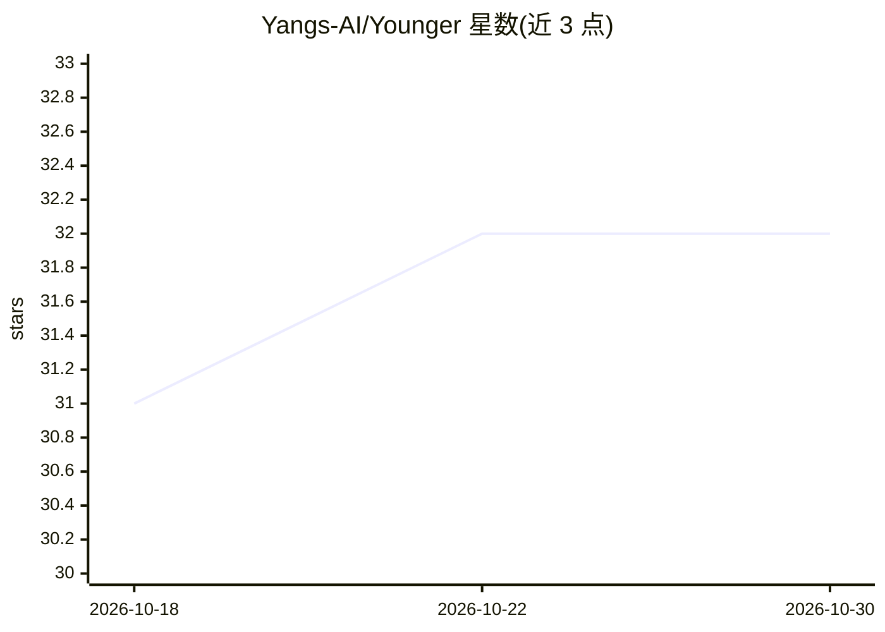

# Yangs-AI/Younger

⭐ 32 · Python · Apache-2.0 · 推送 2026-10-23 · [GitHub](https://github.com/Yangs-AI/Younger) · [官网](https://datasets.yangs.ai/younger) · 组织维护

**AI 生成神经网络架构数据集（Younger）及其配套代码库**

维护 Younger 数据集相关代码与应用的仓库。Younger 是论文所述首个 AI 生成神经网络架构数据集，当前分支代码与论文版本可能不一致，论文对应代码需切换到 paper 分支。代码以多个独立子包形式组织（younger 内核、logics-ir、apps-dl 等），通过 Git submodules 连接、独立发布到 GitHub 与 PyPI，提供 pip 安装与源码可编辑安装两种途径。数据集浏览下载功能首次发布尚未就绪，自动下载与预处理计划在未来版本提供。

## 筛选速览

| 维度 | 判定 | 备注 |
|---|---|---|
| AI 角色 | `ai-knowledge` | 知识聚合/清单类 |
| 许可风险 | `permissive` | Apache-2.0 |
| 部署形态 | `library` | 以包/库形式分发 |
| 模型依赖 | — | README 未给出锁定关系 |
| 硬件要求 | — | 无带数字的原话,不猜 |
| 安装摩擦 | `low` | 无编译、无系统依赖或容器化 |
| 成熟度 | `idea` | |

## 能力要点

- 论文所述首个 AI 生成神经网络架构数据集
- 多子包架构：内核 + logics-ir + apps-dl，经 submodules 独立发布
- pip 安装核心包并按需安装可选功能组（logics/apps）
- paper 分支保留与论文对应的代码版本

## 适用场景

- 获取与论文对应的 Younger 数据集代码
- 基于数据集开展 AI 生成神经网络架构研究
- 以可编辑安装方式参与子包开发与发布流程

## 场景标签

 · 领域:AI 研究/数据集

## 证据(README 行号)

> L3: This repository maintains all code related to using the Younger dataset and its related applications.
> L91: 1. Yang, Z., Gao, W., Peng, L., Huang, Y., Tang, F., & Zhan, J. (2024). Younger: The First Dataset for Artificial I

## 星数曲线

2026-10-18 31 → 2026-10-30 32（+1）

---
*卡片 v1 · prompt 1.4 · 生成 2026-10-26 · 置信度 high · 依据 README sha `eaf1f8b050dc` · [字段定义](../../DATASET.md)*
