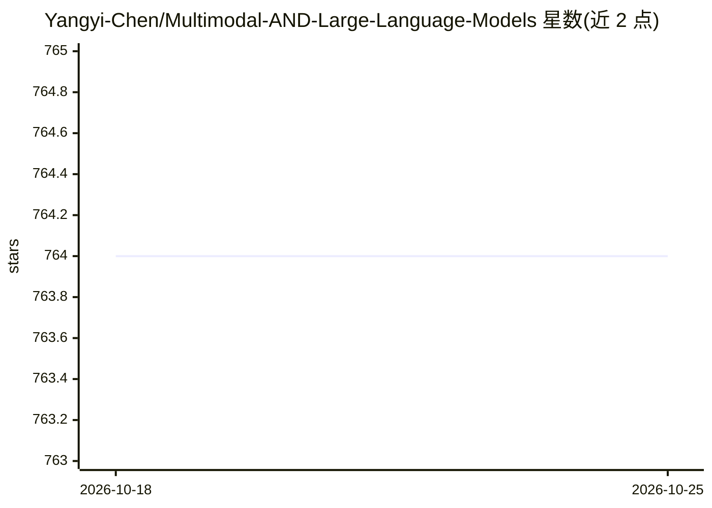

# Yangyi-Chen/Multimodal-AND-Large-Language-Models

⭐ 764 · 推送 2026-05-21 · [GitHub](https://github.com/Yangyi-Chen/Multimodal-AND-Large-Language-Models) · 个人维护

**个人维护的多模态与大语言模型论文阅读清单**

作者为记录每日 arXiv 论文阅读而整理的个人论文清单，覆盖 cs.AI、cs.CL、cs.CV、cs.LG 四个 arXiv 分区。内容按 Survey、Position Paper、Structure（事件抽取、情境识别、场景图等子类）组织，收录综述类（对齐、幻觉、Agent、推理效率等）与结构化多模态任务论文，部分条目附简短笔记。2024 年 6 月起作者聚焦记录自认为有独特见解与实质性贡献的论文。无安装、无代码、无运行方式，仅以 Markdown 列表形式提供。

## 筛选速览

| 维度 | 判定 | 备注 |
|---|---|---|
| AI 角色 | `ai-knowledge` | 知识聚合/清单类 |
| 许可风险 | `none` | — |
| 部署形态 | `None` |  |
| 模型依赖 | — | README 未给出锁定关系 |
| 硬件要求 | — | 无带数字的原话,不猜 |
| 安装摩擦 | `low` | 无编译、无系统依赖或容器化 |
| 成熟度 | — | 结构信号不足 |

## 能力要点

- 覆盖多模态与 LLM 方向的论文清单，按主题分类组织
- 声明只覆盖 cs.AI/cs.CL/cs.CV/cs.LG 四个 arXiv 分区
- 部分条目附作者笔记（如基准、任务焦点说明）

## 适用场景

- 查找多模态与 LLM 方向的代表性综述
- 按子领域（事件抽取/情境识别/场景图）浏览论文
- 跟踪个人筛选后的研究阅读路线

## 场景标签

`精选清单` · 领域:学习与行业

## 证据(README 行号)

> L3: **Note:** This paper list is only used to record papers I read in the daily arxiv for personal needs. I only subscri
> L11: - **Multimodal Learning with Transformers: A Survey;** Peng Xu, Xiatian Zhu, David A. Clifton

## 星数曲线

2026-10-18 764 → 2026-10-25 764（+0）

---
*卡片 v1 · prompt 1.4 · 生成 2026-10-21 · 置信度 high · 依据 README sha `352914b2d803` · [字段定义](../../DATASET.md)*
