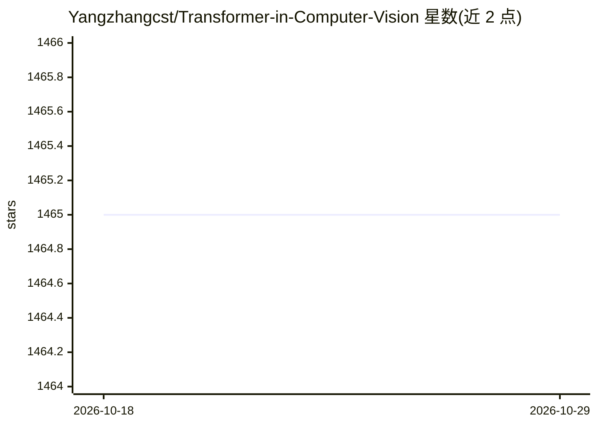

# Yangzhangcst/Transformer-in-Computer-Vision

⭐ 1,465 · 推送 2025-11-19 · [GitHub](https://github.com/Yangzhangcst/Transformer-in-Computer-Vision) · 个人维护

**Transformer 视觉论文清单：汇集近年基于 Transformer 的 CV 论文**

论文收集清单项目，按主题汇集近年基于 Transformer 的计算机视觉研究论文，条目附论文链接及代码链接（如有），通过目录组织内容。维护者接受 issue 与 pull request 补充遗漏论文，最新更新至 2025/11/19，旧版本（20240323）仍可通过链接查看。面向计算机视觉与深度学习方向的研究者和学生，用于检索和跟踪领域论文及开源实现。

## 筛选速览

| 维度 | 判定 | 备注 |
|---|---|---|
| AI 角色 | `ai-knowledge` | 知识聚合/清单类 |
| 许可风险 | `none` | — |
| 部署形态 | `None` |  |
| 模型依赖 | — | README 未给出锁定关系 |
| 硬件要求 | — | 无带数字的原话,不猜 |
| 安装摩擦 | `low` | 无编译、无系统依赖或容器化 |
| 成熟度 | — | 结构信号不足 |

## 能力要点

- 按主题目录组织 Transformer 视觉论文条目
- 条目附论文与代码链接（如有）
- 通过 issue/pull request 接受社区补充

## 适用场景

- 查找某个 Transformer CV 方向的代表论文与代码
- 跟踪 Transformer 在计算机视觉领域的新工作

## 场景标签

`精选清单` · 领域:学习与行业

## 证据(README 行号)

> L3: A paper list of some recent Transformer-based CV works. If you find some ignored papers, please open issues or pull 
> L5: !!The latest version has been updated, and you can click on the following links to view the list of papers and the c

## 星数曲线

2026-10-18 1,465 → 2026-10-29 1,465（+0）

---
*卡片 v1 · prompt 1.4 · 生成 2026-10-21 · 置信度 high · 依据 README sha `096b831eb285` · [字段定义](../../DATASET.md)*
