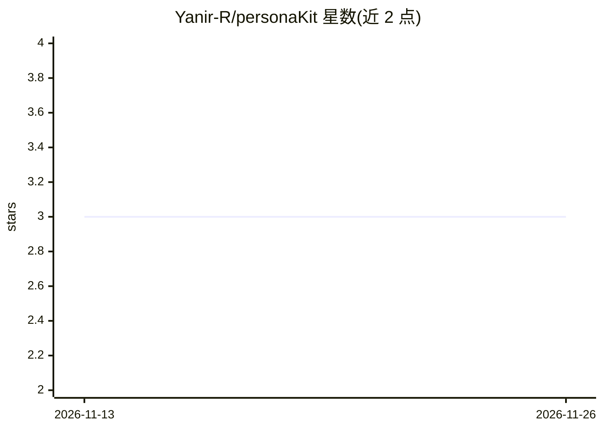

# Yanir-R/personaKit

⭐ 3 · Python · Apache-2.0 · 推送 2026-11-24 · [GitHub](https://github.com/Yanir-R/personaKit) · [官网](https://personakit.me) · 个人维护

**AI 助手的本地记忆层：提取、存储并按许可复用对话记忆**

PersonaKit 读取用户与 AI 助手已有的对话会话文件，用用户已登录的 claude 或 codex CLI 调用模型提取候选记忆，每条记忆附带来源引文，存入本机单个 SQLite 文件。记忆分 unconfirmed/approved/restricted/archived 四种状态，只有 approved 与 unconfirmed 会通过 MCP server（stdio）提供给助手，用户可批准、限制、隐藏或遗忘任意记忆。无独立服务端与账号，无遥测。当前为 0.2 早期版本：排序为词重叠匹配，非拉丁字符不匹配，提取结果需人工审阅。

## 筛选速览

| 维度 | 判定 | 备注 |
|---|---|---|
| AI 角色 | `ai-ecosystem` | LLM/agent 周边工具 |
| 许可风险 | `permissive` | Apache-2.0 |
| 部署形态 | `library` | 以包/库形式分发 |
| 模型依赖 | — | README 未给出锁定关系 |
| 硬件要求 | — | 无带数字的原话,不猜 |
| 安装摩擦 | `low` | 无编译、无系统依赖或容器化 |
| 成熟度 | `idea` | |

## 能力要点

- 每条记忆带来源引文（receipt），可追溯为何助手持有该认知
- 四种状态控制服务范围，restricted/archived 永不返回
- MCP stdio server，任何可启动本地 MCP server 的客户端均可接入
- 纯 Python 核心、无必需依赖，单 SQLite 文件本地存储

## 适用场景

- 让 Claude Code 或 Codex 记住我的偏好，且记忆内容我可以审阅修改
- 多个 MCP 客户端共享同一份本地记忆库
- 在不上传对话的前提下给助手提供长期上下文

## 场景标签

`Agent 记忆` · 领域:Agent 开发

## 证据(README 行号)

> L18: and serves only what you allow back to your assistants over MCP. Everything runs on your own
> L53: `personakit serve` is a standard MCP server over stdio, so any client that can launch a local
> L81: 1. **Ingest** reads local session files. Only the turns you wrote leave the parsing step.

## 星数曲线

2026-11-13 3 → 2026-11-26 3（+0）

---
*卡片 v1 · prompt 1.4 · 生成 2026-11-22 · 置信度 high · 依据 README sha `d4c2dd92363e` · [字段定义](../../DATASET.md)*
