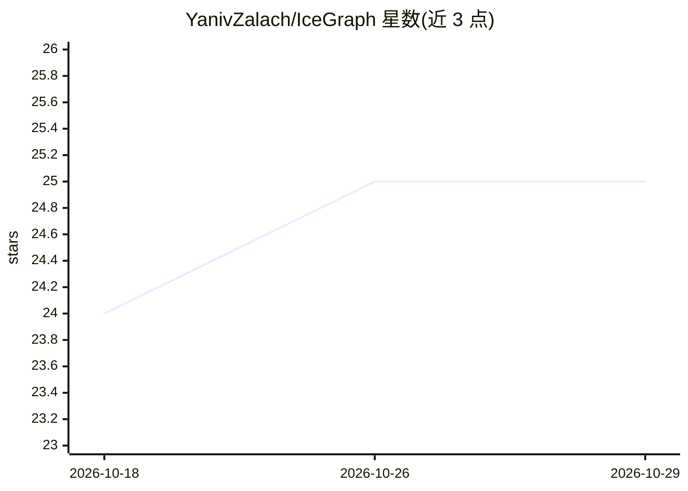

# YanivZalach/IceGraph

⭐ 25 · TypeScript · AGPL-3.0 · 推送 2026-10-27 · [GitHub](https://github.com/YanivZalach/IceGraph) · [官网](https://yanivzalach.github.io/IceGraph-Site/) · 个人维护

**Apache Iceberg 元数据调试与图可视化平台，面向数据工程师**

基于 Spark Connect 后端的只读交互式调试工具：以层级图 UI 展示 Iceberg 表的快照、manifest、数据文件与 delete 文件，追踪元数据演进、提交与 schema 变更，提供分区/文件浏览器及 Python 客户端 icegraph-client 与 CLI。仅支持 Spark Connect 3.5.4（其他版本需改配置自行构建），多副本部署需会话亲和。通过 Docker 镜像或源码（uv + pnpm）运行。项目描述中提及 AI 辅助探索，README 正文未展开。

## 筛选速览

| 维度 | 判定 | 备注 |
|---|---|---|
| AI 角色 | `ai-enhanced` | 去掉 AI 部分产品仍成立 |
| 许可风险 | `viral` | AGPL-3.0 |
| 部署形态 | `self-host` | docker 或自建部署 |
| 模型依赖 | — | README 未给出锁定关系 |
| 硬件要求 | — | 无带数字的原话,不猜 |
| 安装摩擦 | `low` | 无编译、无系统依赖或容器化 |
| 成熟度 | — | 结构信号不足 |

## 能力要点

- 层级图 UI 展示快照/manifest/数据文件与多分支
- 只读、生产安全，不修改表数据或元数据
- Python 客户端与 CLI（icegraph-client）脚本访问
- 支持 Iceberg format v1/v2/v3

## 适用场景

- 调试生产 Iceberg 表的复杂状态与元数据演进
- 学习 Iceberg 内部结构（快照、manifest、文件布局）
- 通过 CLI/Python 脚本访问表的元数据图

## 场景标签

 · 领域:数据工程/湖仓表调试

## 证据(README 行号)

> L5: **IceGraph** is an interactive Apache Iceberg debugging and visualization platform that provides a hierarchical, gra
> L17: * **Production-Safe & Read-Only** — Built for production Iceberg tables without modifying data or metadata.

## 星数曲线

2026-10-18 24 → 2026-10-29 25（+1）

---
*卡片 v1 · prompt 1.4 · 生成 2026-10-27 · 置信度 low · 依据 README sha `439b6d2038bd` · [字段定义](../../DATASET.md)*
