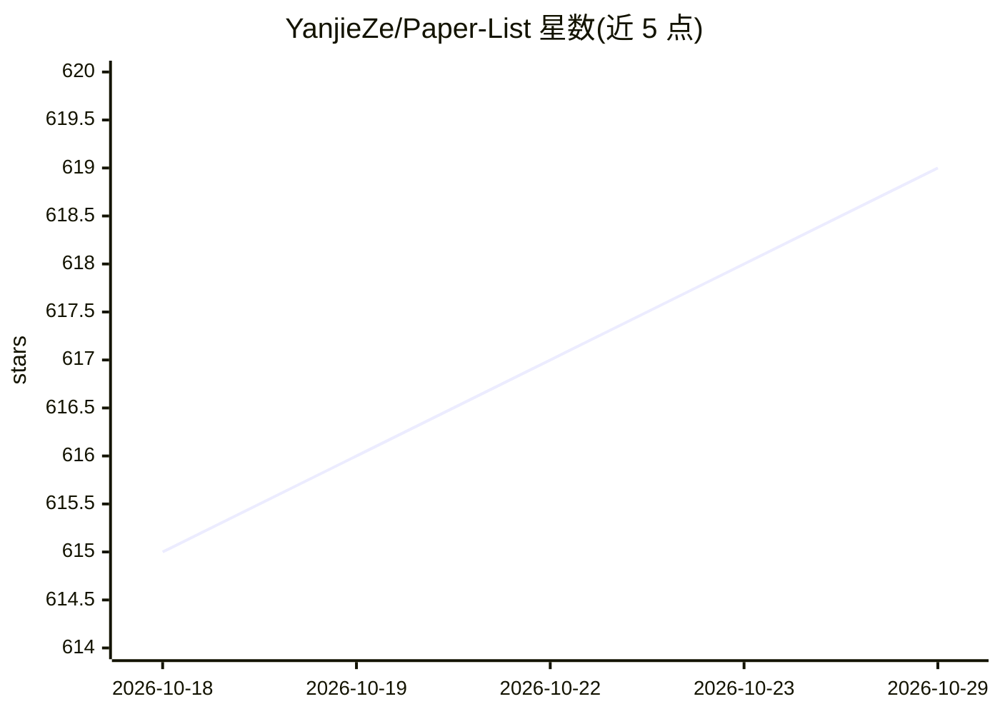

# YanjieZe/Paper-List

⭐ 619 · Python · 推送 2026-10-28 · [GitHub](https://github.com/YanjieZe/Paper-List) · 个人维护

**个人维护的机器人学习与视觉 ML 论文阅读清单**

Yanjie Ze 维护的个人论文列表：按主题分为机器人学习（自我改进、世界模型、人形机器人、灵巧操作、3D 机器人学习等）、视觉与生成模型（3D 视觉、扩散模型、LLM 等）及其他；同时按会议与年份（RSS/CVPR/ICLR/CoRL/NeurIPS 等 2022-2025）组织条目，并持续追加 arXiv 新论文。内容以论文标题与链接形式列出，覆盖世界-动作模型、VLA、机器人基础模型等方向。无安装或运行方式，仅为阅读导航用途。

## 筛选速览

| 维度 | 判定 | 备注 |
|---|---|---|
| AI 角色 | `ai-knowledge` | 知识聚合/清单类 |
| 许可风险 | `none` | — |
| 部署形态 | `None` |  |
| 模型依赖 | — | README 未给出锁定关系 |
| 硬件要求 | — | 无带数字的原话,不猜 |
| 安装摩擦 | `low` | 无编译、无系统依赖或容器化 |
| 成熟度 | — | 结构信号不足 |

## 能力要点

- 按机器人学习/视觉生成模型两大主题组织的策展视图
- 覆盖 2022-2025 年主流会议（RSS/CVPR/ICLR/CoRL/NeurIPS 等）条目
- 持续更新的 arXiv 近期论文收件箱

## 适用场景

- 跟踪机器人学习与世界模型方向的最新论文
- 按主题浏览灵巧操作、VLA、机器人基础模型文献
- 查找近年机器人相关会议的论文入口

## 场景标签

`精选清单` · 领域:学习与行业

## 证据(README 行号)

> L1: # A Paper List of Yanjie Ze
> L5: Robot learning
> L24: Papers:

## 星数曲线

2026-10-18 615 → 2026-10-29 619（+4）

---
*卡片 v1 · prompt 1.4 · 生成 2026-10-21 · 置信度 high · 依据 README sha `6697e2ceea3d` · [字段定义](../../DATASET.md)*
