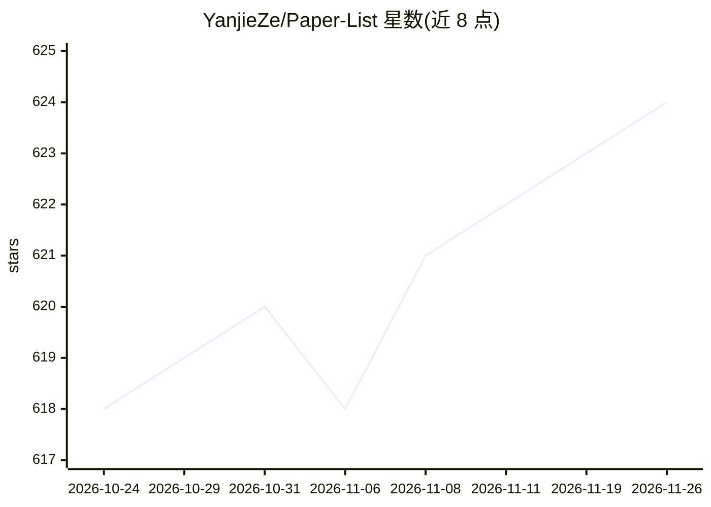

# YanjieZe/Paper-List

⭐ 624 · Python · 推送 2026-11-14 · [GitHub](https://github.com/YanjieZe/Paper-List) · 个人维护

**研究者个人维护的机器人学习与视觉论文清单**

由 Yanjie Ze 维护的个人论文清单，按主题与时间组织条目：主题包括机器人学习（自我改进机器人、世界模型/世界-动作模型、机器人基础模型、人形机器人、灵巧操作等）与视觉/生成模型/ML 两大板块；同时按会议与年份（RSS/CVPR/ICLR/CoRL/NeurIPS 等 2022-2025）整理条目，并附有按 arXiv 时间倒序排列的近期论文列表与部分网站条目。以 Markdown 文档形式提供，无需安装运行。

## 筛选速览

| 维度 | 判定 | 备注 |
|---|---|---|
| AI 角色 | `ai-knowledge` | 知识聚合/清单类 |
| 许可风险 | `none` | — |
| 部署形态 | `None` |  |
| 模型依赖 | — | README 未给出锁定关系 |
| 硬件要求 | — | 无带数字的原话,不猜 |
| 安装摩擦 | `low` | 无编译、无系统依赖或容器化 |
| 成熟度 | — | 结构信号不足 |

## 能力要点

- 按主题组织的机器人学习论文分类（世界模型、基础模型、灵巧操作等）
- 按会议与年份（2022-2025）整理的论文索引
- 按 arXiv 时间倒序排列的近期论文滚动列表

## 适用场景

- 查找机器人学习与世界模型方向的论文线索
- 按会议与年份浏览 CV/ML 顶会论文
- 跟踪作者近期关注的 arXiv 新论文

## 场景标签

`精选清单` `科研工具` · 领域:学习与行业

## 证据(README 行号)

> L1: # A Paper List of Yanjie Ze
> L5: Robot learning
> L24: Papers:

## 星数曲线

2026-10-24 618 → 2026-11-26 624（+6）

---
*卡片 v1 · prompt 1.4 · 生成 2026-11-25 · 置信度 high · 依据 README sha `765ec78fc307` · [字段定义](../../DATASET.md)*
