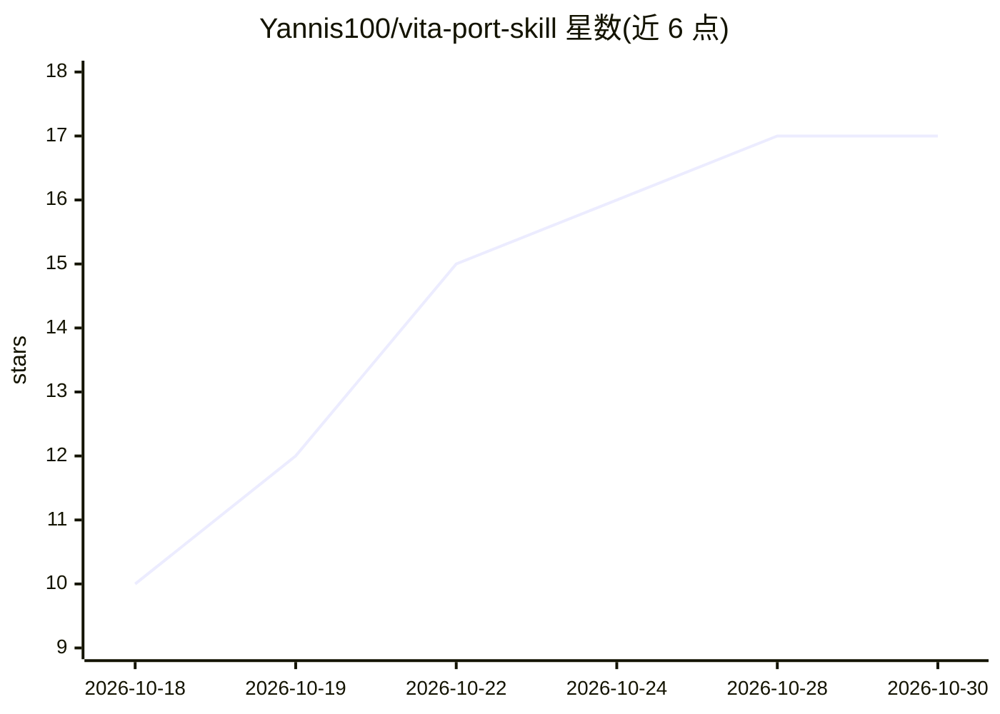

# Yannis100/vita-port-skill

⭐ 17 · Python · MIT · 推送 2026-10-26 · [GitHub](https://github.com/Yannis100/vita-port-skill) · [官网](https://skills.sh/Yannis100/vita-port-skill) · 个人维护

**将游戏与应用移植到 PS Vita 的 agent 技能包**

发布两个 agent skill：vita-port 面向游戏移植（VitaSDK、vitaGL、Android .so 加载、静态重编译、API 仿真），vita-app-port 面向 Android 应用与非游戏工具。内容覆盖六条移植路线的可行性分诊、工具链与 CMake 配置、内存与线程映射、OpenGL→vitaGL 着色器转换、输入映射、VPK 打包与崩溃调试（Vita3K 等）。通过 npx skills add 安装，可指定 agent 或全局安装，MIT 许可。

## 筛选速览

| 维度 | 判定 | 备注 |
|---|---|---|
| AI 角色 | `ai-knowledge` | 知识聚合/清单类 |
| 许可风险 | `permissive` | MIT |
| 部署形态 | `library` | 以包/库形式分发 |
| 模型依赖 | — | README 未给出锁定关系 |
| 硬件要求 | — | 无带数字的原话,不猜 |
| 安装摩擦 | `medium` | 含编译或系统依赖之一 |
| 成熟度 | — | 结构信号不足 |

## 能力要点

- 两条技能覆盖游戏移植与 Android 应用移植
- 六条移植路线（VitaSDK/vitaGL/API 仿真/.so 加载/TeaVM/静态重编译）分诊
- OpenGL→vitaGL 着色器转换与缓存、输入映射、VPK 打包校验
- Vita3K/vitacompanion 等调试指引

## 适用场景

- 让 AI agent 辅助评估和执行 PS Vita 移植工作
- 查找 VitaSDK/vitaGL 工具链配置与打包流程指引
- 调试 Vita 移植中的崩溃问题

## 场景标签

`编码 Agent` · 领域:编码与开发

## 证据(README 行号)

> L3: Agent skills for porting software to the Sony PS Vita (PSVita / PS TV) as VPK homebrew.
> L9: - **vita-port** — porting games to the PS Vita (VitaSDK, vitaGL, Android .so loader, static
> L22: - Feasibility triage: six port routes (native VitaSDK, vitaGL, cross-platform API emulation,

## 星数曲线

2026-10-18 10 → 2026-10-30 17（+7）

---
*卡片 v1 · prompt 1.4 · 生成 2026-10-29 · 置信度 high · 依据 README sha `1ac0f6fb507d` · [字段定义](../../DATASET.md)*
