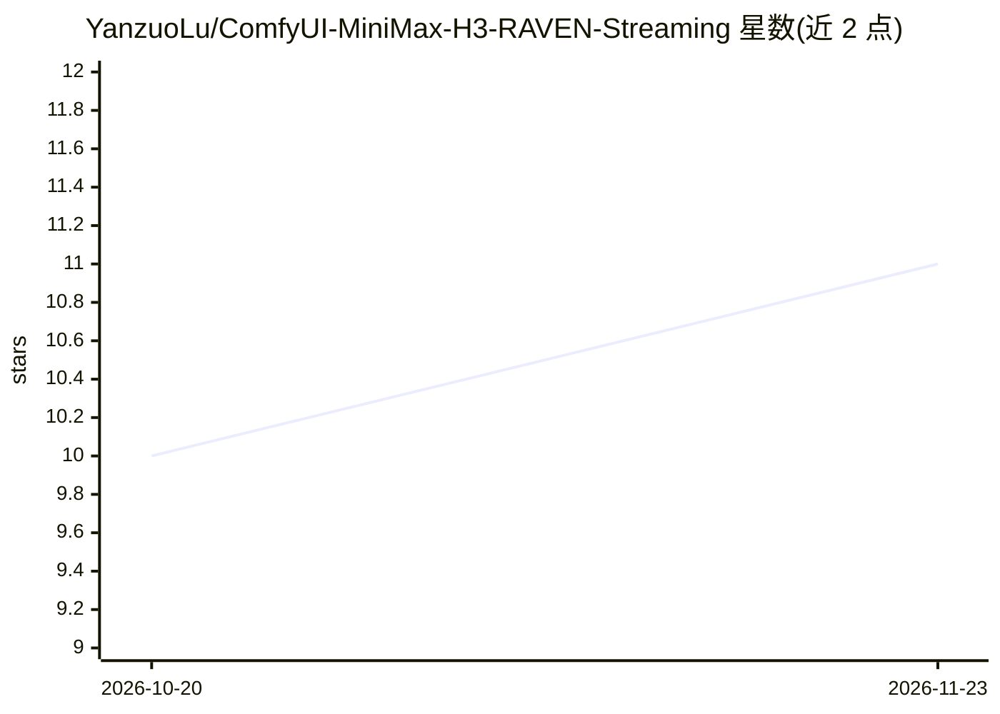

# YanzuoLu/ComfyUI-MiniMax-H3-RAVEN-Streaming

⭐ 11 · Python · MIT · 推送 2026-08-20 · [GitHub](https://github.com/YanzuoLu/ComfyUI-MiniMax-H3-RAVEN-Streaming) · 个人维护

**为 ComfyUI 提供 MiniMax H3 流式文生视频+音频的节点包**

面向 ComfyUI 用户的自定义节点包：基于 ComfyUI 官方 H3 实现与必装的 RAVEN LoRA，提供两个节点（RAVEN Model Loader、RAVEN Streaming Sampler），执行 chunk-major 流式 rollout，逐块解码生成视频与音频（T2VA）。LoRA 以 FP32 激活残差方式应用以支持部分 CPU offload，流式预览经 fMP4（PyAV）分块输出；仅实现无条件/参考行的因果 packed 布局，带条件行时拒绝执行。权重随模型单独分发且采用独立上游许可，仓库本身为 MIT。

## 筛选速览

| 维度 | 判定 | 备注 |
|---|---|---|
| AI 角色 | `ai-native` | 本体是模型或模型工具 |
| 许可风险 | `permissive` | MIT |
| 部署形态 | `library` | 以包/库形式分发 |
| 模型依赖 | — | README 未给出锁定关系 |
| 硬件要求 | — | 无带数字的原话,不猜 |
| 安装摩擦 | `medium` | 含编译或系统依赖之一 |
| 成熟度 | — | 结构信号不足 |

## 能力要点

- 两个节点接入 ComfyUI 官方 H3 工作流，生成视频与音频双流输出
- chunk-major 流式采样器，逐块解码并支持流式预览
- RAVEN LoRA 以 FP32 激活残差应用，支持部分 CPU offload
- 提供 UI 工作流模板与 API prompt 两种示例图

## 适用场景

- 在 ComfyUI 中用 MiniMax H3 从文本生成同步视频与音频
- 长时间片段的流式预览与分块生成
- 在显存受限时通过 CPU/GPU 混合 offload 运行模型

## 场景标签

`视频生成` · 领域:内容生成

## 证据(README 行号)

> L3: Streaming **text-to-video-and-audio (T2VA)** custom nodes for **MiniMax H3**,
> L4: built on top of ComfyUI's *official* H3 implementation and a **mandatory RAVEN

## 星数曲线

2026-10-20 10 → 2026-11-23 11（+1）

---
*卡片 v1 · prompt 1.4 · 生成 2026-11-20 · 置信度 mid · 依据 README sha `a6354a244e6e` · [字段定义](../../DATASET.md)*
