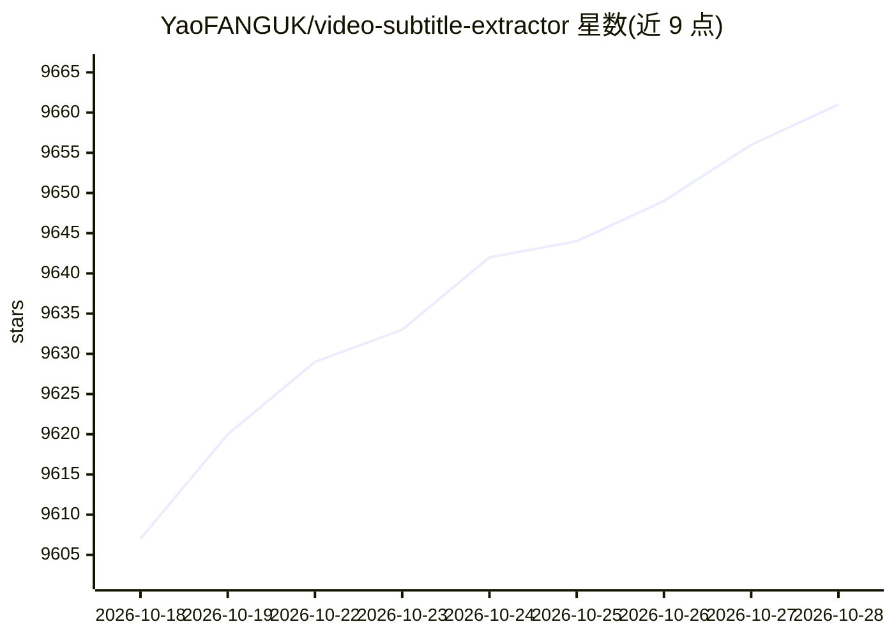

# YaoFANGUK/video-subtitle-extractor

⭐ 9,668 · Python · Apache-2.0 · 推送 2026-04-09 · [GitHub](https://github.com/YaoFANGUK/video-subtitle-extractor) · 个人维护 · 中文 README

**本地 OCR 提取视频硬字幕并生成 srt 文件的 GUI 工具**

Video-subtitle-extractor (VSE) 将视频中的硬字幕提取为外挂 srt/txt 字幕文件，流程包含关键帧提取、字幕区域检测、文本内容识别、非字幕区域过滤与去重。OCR 全部本地运行，无需接入第三方 API。提供快速/自动/精准三种模式，支持 87 种语言与批量提取。提供 GUI 与 CLI 两种界面；Windows/Linux/macOS 可从源码运行（Python 3.12+），并支持 CUDA、DirectML、ONNX、CPU 四种运行模式。限制：路径含中文或空格可能出错。

## 筛选速览

| 维度 | 判定 | 备注 |
|---|---|---|
| AI 角色 | `ai-native` | 本体是模型或模型工具 |
| 许可风险 | `permissive` | Apache-2.0 |
| 部署形态 | `desktop` | 安装包/桌面程序 |
| 模型依赖 | — | README 未给出锁定关系 |
| 硬件要求 | — | 无带数字的原话,不猜 |
| 安装摩擦 | `medium` | 含编译或系统依赖之一 |
| 成熟度 | — | 结构信号不足 |

## 能力要点

- 本地 OCR 识别，无需调用第三方在线 OCR API
- 支持 87 种语言字幕提取与批量处理
- CUDA/DirectML/ONNX/CPU 四种运行模式
- 提供 GUI 与 CLI，支持水印/台标文本去除与自定义文本替换

## 适用场景

- 把视频中的硬字幕提取为 srt 外挂字幕文件
- 批量提取分辨率与字幕区域一致的多 个视频的字幕
- 去除水印、台标文本并替换特定识别错字

## 场景标签

`OCR` · 领域:感知与多模态

## 证据(README 行号)

> L15: - 检测视频帧中文本的所在位置
> L16: - 识别视频帧中文本的内容
> L33: - 采用本地进行OCR识别，无需设置调用任何API，不需要接入百度、阿里等在线OCR服务即可本地完成文本识别

## 星数曲线

2026-10-18 9,607 → 2026-10-28 9,661（+54）

---
*卡片 v1 · prompt 1.4 · 生成 2026-10-20 · 置信度 mid · 依据 README sha `0a67078104a9` · [字段定义](../../DATASET.md)*
