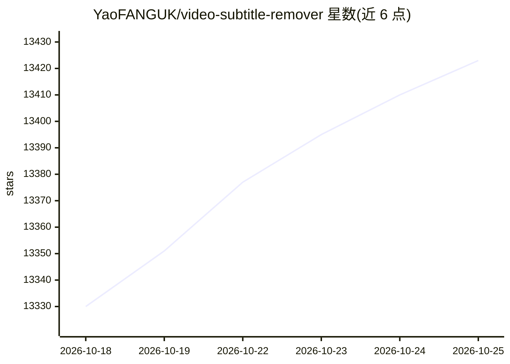

# YaoFANGUK/video-subtitle-remover

⭐ 13,435 · Python · Apache-2.0 · 推送 2026-06-30 · [GitHub](https://github.com/YaoFANGUK/video-subtitle-remover) · 个人维护 · 中文 README

**给需要去除视频硬字幕/文本水印的用户，本地AI修复填充**

基于AI的视频/图片硬字幕与文本水印去除工具：对字幕区域进行填充（非相邻像素填充），以无损分辨率输出去除后的文件。支持自定义字幕位置或全视频自动去除所有文本，支持图片批量去水印。内置 GUI 与 CLI 两种使用方式，去除算法含 STTN、LAMA、ProPainter 三种可配置模式，模型可通过 backend/tools/train 自行训练替换。本地运行，无需申请第三方 API。Windows 提供多个预构建包，也可源码安装。

## 筛选速览

| 维度 | 判定 | 备注 |
|---|---|---|
| AI 角色 | `ai-enhanced` | 去掉 AI 部分产品仍成立 |
| 许可风险 | `permissive` | Apache-2.0 |
| 部署形态 | `self-host` | docker 或自建部署 |
| 模型依赖 | — | README 未给出锁定关系 |
| 硬件要求 | — | 无带数字的原话,不猜 |
| 安装摩擦 | `low` | 无编译、无系统依赖或容器化 |
| 成熟度 | — | 结构信号不足 |

## 动量与使用信号

- 维护:`maintenance` — 距上次 push 110.3 天,年发版 1,3 位贡献者
- 涨星:近 1 天 **+15**(自 20261016 起算)
- 安装:pypi 包 `paddlepaddle-gpu` 月下载 17,378
- 平台:WINDOWS / MACOS / LINUX · 协议:—

## 能力要点

- 无损分辨率去除硬字幕/文本水印，本地运行无需第三方 API
- 三种填充算法可选（STTN/LAMA/ProPainter），参数可调
- 支持 CUDA、DirectML、CPU、macOS Apple Silicon 四种运行模式
- 提供 GUI、CLI、Docker 三种使用方式

## 适用场景

- 去除视频中嵌入的硬字幕并保留原分辨率
- 批量去除图片上的文本水印
- 无 NVIDIA 显卡时用 DirectML 或 CPU 模式运行
- 对去字幕效果不满意时自行训练替换模型

## 场景标签

`图像视频处理` · 领域:感知与多模态

## 证据(README 行号)

> L15: Video-subtitle-remover (VSR) 是一款基于AI技术，将视频中的硬字幕去除的软件。
> L115: 本项目支持 CUDA (NVIDIA显卡加速)、CPU (无 GPU)、 DirectML (AMD、Intel等GPU/APU加速) 和 macOS (Apple Silicon) 四种运行模式。
> L19: - 提取原视频字幕，可配合：video-subtitle-extractor (VSE)

## 星数曲线

2026-10-18 13,330 → 2026-10-25 13,423（+93）

---
*卡片 v1 · prompt 1.4 · 生成 2026-10-18 · 置信度 high · 依据 README sha `51e13754f074` · [字段定义](../../DATASET.md)*
