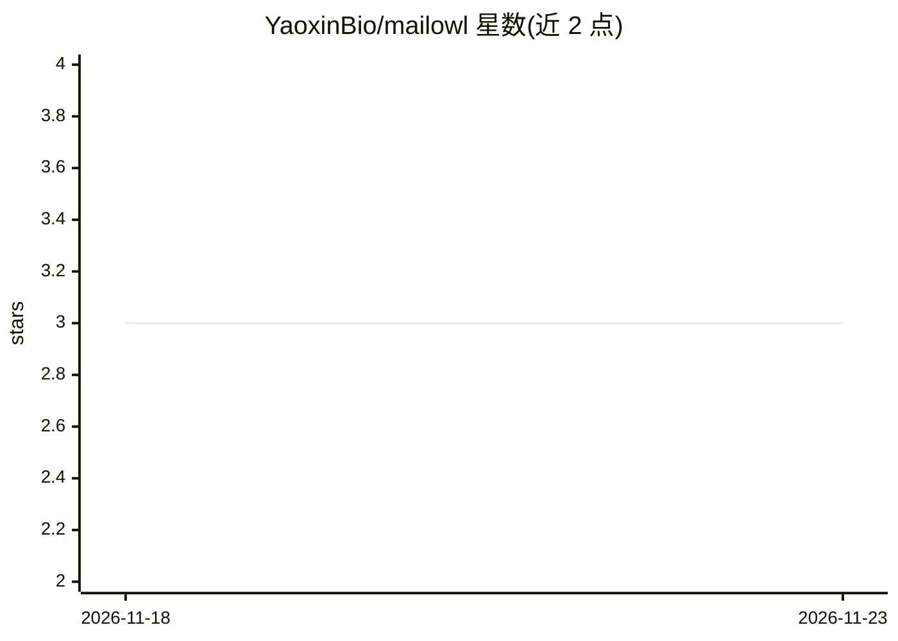

# YaoxinBio/mailowl

⭐ 3 · Python · MIT · 推送 2026-11-06 · [GitHub](https://github.com/YaoxinBio/mailowl) · 个人维护 · 中文 README

**Mac 上的本地 AI 邮件秘书：代拟回复但不经确认不发信**

运行在 macOS 上的自托管邮件助手：通过只读 IMAP/POP3 轮询多个邮箱并写入本地 SQLite，不做服务器端改动。LLM 对新邮件分级（0–3）、生成摘要与待办；低优先级合并为每日摘要，紧急邮件推送聊天卡片与 Bark 手机提醒。回复草稿检索历史往来邮件、匹配线程语言与签名模板，须在聊天应用中点 Confirm 并二次确认才会发出。读信 agent 架构上无发送工具与网络访问；模型后端可换成本地 Ollama。仅支持 macOS 与应用密码登录的邮箱。

## 筛选速览

| 维度 | 判定 | 备注 |
|---|---|---|
| AI 角色 | `ai-native` | 本体是模型或模型工具 |
| 许可风险 | `permissive` | MIT |
| 部署形态 | `None` |  |
| 模型依赖 | local-ok | 支持本地模型 |
| 硬件要求 | — | 无带数字的原话,不猜 |
| 安装摩擦 | `low` | 无编译、无系统依赖或容器化 |
| 成熟度 | `idea` | |

## 能力要点

- 读信 agent 无发送工具与网络访问，发送需两次确认且每草稿限一次
- 邮件全部存本地 SQLite，支持本地 Ollama 模型实现零外发推理
- 按 0–3 优先级分级通知：摘要、聊天卡片、Bark 锁屏提醒
- 草稿匹配线程语言并引用历史往来邮件

## 适用场景

- 多邮箱统一分诊，只被提醒需要动手处理的邮件
- 让 AI 按我的语气起草回复，我确认后才发出
- 担心提示注入与邮箱数据外泄，想要本地化方案

## 场景标签

 · 领域:个人效率/邮件管理

## 证据(README 行号)

> L5:  A local-first AI email secretary that drafts in your voice and never sends without your say-so.
> L33: 2. **Triage** — An LLM evaluates each new arrival and extracts a priority level (`0`–`3`), a one-line summary, any 
> L61: - **Bring your own model** — Run against the local Claude Code CLI already logged in on your Mac, or point MailOwl 

## 星数曲线

2026-11-18 3 → 2026-11-23 3（+0）

---
*卡片 v1 · prompt 1.4 · 生成 2026-11-22 · 置信度 high · 依据 README sha `0ba5a1feb5aa` · [字段定义](../../DATASET.md)*
