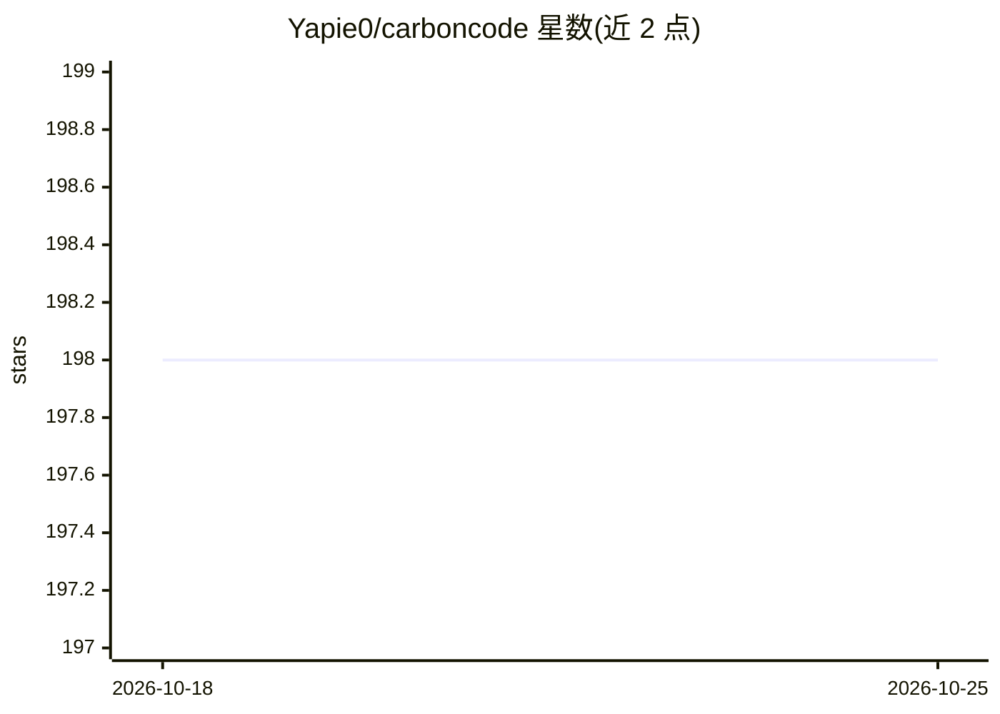

# Yapie0/carboncode

⭐ 198 · TypeScript · MIT · 推送 2026-08-10 · [GitHub](https://github.com/Yapie0/carboncode) · [官网](https://yapie0.github.io/carboncode/) · 个人维护 · 中文 README

**基于 DeepSeek 的命令行编码智能体，代码修改与任务自动执行**

TypeScript 编写的终端编码智能体（CLI/TUI）：在项目目录启动后读取并搜索代码、提出修改方案并以 diff 展示、运行 shell 命令前征求确认、按需运行测试并留会话记录；支持任务自动拆分、MCP 测试与多 Agent 协作。模型预设绑定 DeepSeek V4（flash/pro/auto 自动升级），配置 API Key 即用；桌面端另支持 OpenAI 兼容提供方。附带 carboncode init 项目规则生成、doctor 健康检查、可关闭的脱敏错误诊断上传。需 Node.js 22+，npm 全局安装。

## 筛选速览

| 维度 | 判定 | 备注 |
|---|---|---|
| AI 角色 | `ai-native` | 本体是模型或模型工具 |
| 许可风险 | `permissive` | MIT |
| 部署形态 | `library` | 以包/库形式分发 |
| 模型依赖 | locked-api |  |
| 硬件要求 | — | 无带数字的原话,不猜 |
| 安装摩擦 | `low` | 无编译、无系统依赖或容器化 |
| 成熟度 | — | 结构信号不足 |

## 能力要点

- diff 展示修改方案并在运行 shell 命令前征求确认
- DeepSeek V4 模型预设（flash/pro/auto 按难度自动升级）
- carboncode init 分析项目生成 CARBON.md 规则文件，不调用模型
- 桌面端支持 OpenAI 兼容提供方自动发现 /models 并适配两种 API

## 适用场景

- 在终端用自然语言让 AI 修改和验证项目代码
- 非交互式执行一次性编码任务（carboncode run）
- 为已有项目生成 AGENTS.md/CARBON.md 项目规则文件

## 场景标签

`编码 Agent` · 领域:编码与开发

## 证据(README 行号)

> L3: Carbon Code 是一款类似 Claude Code 的代码开发工具，也是中国第一个基于 DeepSeek 的代码开发工具，Token 成本节省 90% 以上。它可以实现自动任务拆分、自动开发、MCP 测试，以及与 Claud
> L5: 在项目目录中启动后，它会读取并搜索你的代码、提出修改方案并以 diff 展示、在运行 shell 命令前征求你的确认、按需运行测试验证，并为每次会话留下简洁的记录。

## 星数曲线

2026-10-18 198 → 2026-10-25 198（+0）

---
*卡片 v1 · prompt 1.4 · 生成 2026-10-22 · 置信度 high · 依据 README sha `042099c91d63` · [字段定义](../../DATASET.md)*
