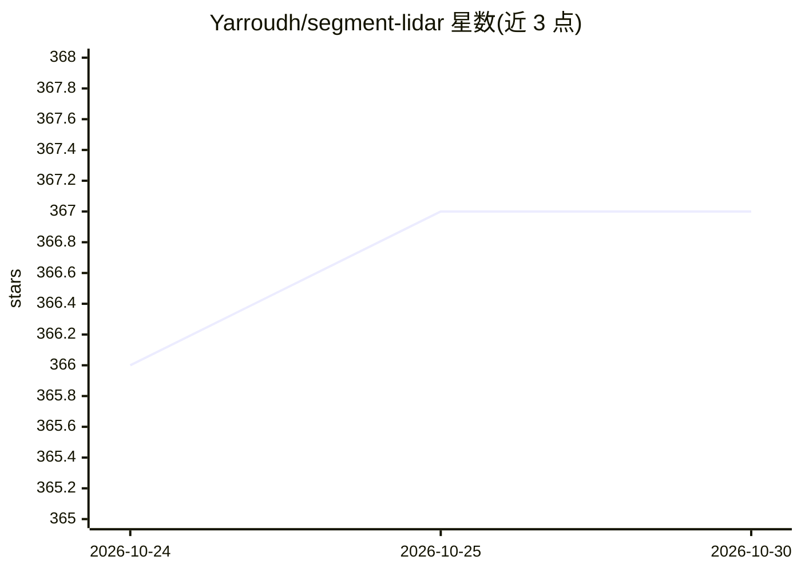

# Yarroudh/segment-lidar

⭐ 367 · Python · BSD-3-Clause · 推送 2026-10-24 · [GitHub](https://github.com/Yarroudh/segment-lidar) · [官网](https://yarroudh.github.io/segment-lidar/) · 组织维护

**用 Meta SAM 3 对航空 LiDAR 点云做实例分割的 Python 库**

面向点云处理开发者与地理信息/遥感从业者的 Python 包：将 3D 点云投影为图像，调用 Meta AI 的 Segment Anything Model 3 生成实例掩膜，再把实例标签回传到原始点云。支持自动掩膜生成、文本提示、框提示、顶视图与针孔相机投影、地面滤波（可选 CSF）以及 LAS/LAZ 输出。SAM 3 为 Hugging Face 上的受限模型，需申请访问并设置 HF_TOKEN；推理在本地运行，首次运行下载模型文件。推荐使用 CUDA GPU，也支持 CPU（速度较慢）。提供 PyPI 安装与 Docker 镜像。

## 筛选速览

| 维度 | 判定 | 备注 |
|---|---|---|
| AI 角色 | `ai-native` | 本体是模型或模型工具 |
| 许可风险 | `permissive` | BSD-3-Clause |
| 部署形态 | `self-host` | docker 或自建部署 |
| 模型依赖 | — | README 未给出锁定关系 |
| 硬件要求 | — | 无带数字的原话,不猜 |
| 安装摩擦 | `low` | 无编译、无系统依赖或容器化 |
| 成熟度 | — | 结构信号不足 |

## 能力要点

- 点云投影→SAM 3 分割→实例标签回传 3D 点的流程
- 支持文本提示、框提示与自动掩膜生成
- 顶视图与自定义针孔相机投影，输出 LAS/LAZ 与 signed 32 位 segment_id 维度
- 提供 SAM 3 运行时 Docker 镜像，模型文件在推理时下载

## 适用场景

- 对城市航空 LiDAR 点云自动提取建筑物、树木等实例
- 用文本提示（如 building/tree）批量查找点云中特定类别对象
- 将已保存的标签栅格转移到点云，无需加载 SAM 3

## 场景标签

`目标检测` · 领域:感知与多模态

## 证据(README 行号)

> L11: *Python package for instance segmentation of aerial LiDAR data using the
> L14: `segment-lidar` projects a 3D point cloud into an image, uses SAM 3 to find

## 星数曲线

2026-10-24 366 → 2026-10-30 367（+1）

---
*卡片 v1 · prompt 1.4 · 生成 2026-10-23 · 置信度 high · 依据 README sha `155896b060af` · [字段定义](../../DATASET.md)*
