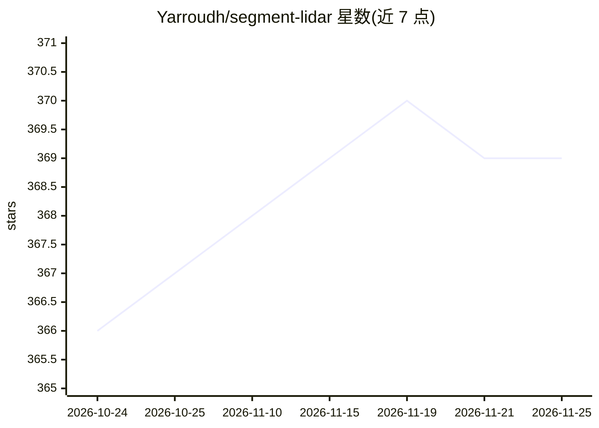

# Yarroudh/segment-lidar

⭐ 369 · Python · BSD-3-Clause · 推送 2026-10-24 · [GitHub](https://github.com/Yarroudh/segment-lidar) · [官网](https://yarroudh.github.io/segment-lidar/) · 组织维护

**给 LiDAR 点云做实例分割的 Python 包，基于 Meta SAM 模型**

segment-lidar 将 3D 点云投影为图像，用 Meta AI 的 SAM 3 找到目标实例，再把实例标签回写到原始点。支持自动掩码生成、文本提示、框提示、顶视图与自定义针孔相机投影、保存的标签栅格复用、可选 CSF 地面滤波，输出 LAS/LAZ 格式并保留点顺序。SAM 3 在 Hugging Face 上为 gated 模型，使用前需申请访问权限并设置 HF_TOKEN；推理可在本地运行，CPU 可用但速度较慢。由 ULiege 测绘单位开发，BSD 3 许可，附 BibTeX 引用信息。

## 筛选速览

| 维度 | 判定 | 备注 |
|---|---|---|
| AI 角色 | `ai-native` | 本体是模型或模型工具 |
| 许可风险 | `permissive` | BSD-3-Clause |
| 部署形态 | `self-host` | docker 或自建部署 |
| 模型依赖 | — | README 未给出锁定关系 |
| 硬件要求 | — | 无带数字的原话,不猜 |
| 安装摩擦 | `low` | 无编译、无系统依赖或容器化 |
| 成熟度 | — | 结构信号不足 |

## 能力要点

- 点云→图像→SAM 3 实例→点云标签的完整分割流程
- 支持自动掩码生成、文本提示、框提示及三者组合
- 支持顶视图与自定义针孔相机投影，可复用已保存标签栅格
- 输出 LAS/LAZ，写入 segment_id 维度并保留点顺序

## 适用场景

- 对城市航空 LiDAR 数据提取建筑、树木等实例并逐点标注
- 用文本或框提示定向分割特定类别目标
- 在已有标签栅格上无需加载模型即可回标点云

## 场景标签

`目标检测` `图像视频处理` · 领域:感知与多模态

## 证据(README 行号)

> L11: *Python package for instance segmentation of aerial LiDAR data using the
> L14: `segment-lidar` projects a 3D point cloud into an image, uses SAM 3 to find
> L16: supports automatic mask generation, text prompts, box prompts, top views,

## 星数曲线

2026-10-24 366 → 2026-11-25 369（+3）

---
*卡片 v1 · prompt 1.4 · 生成 2026-11-25 · 置信度 high · 依据 README sha `3aec86086282` · [字段定义](../../DATASET.md)*
