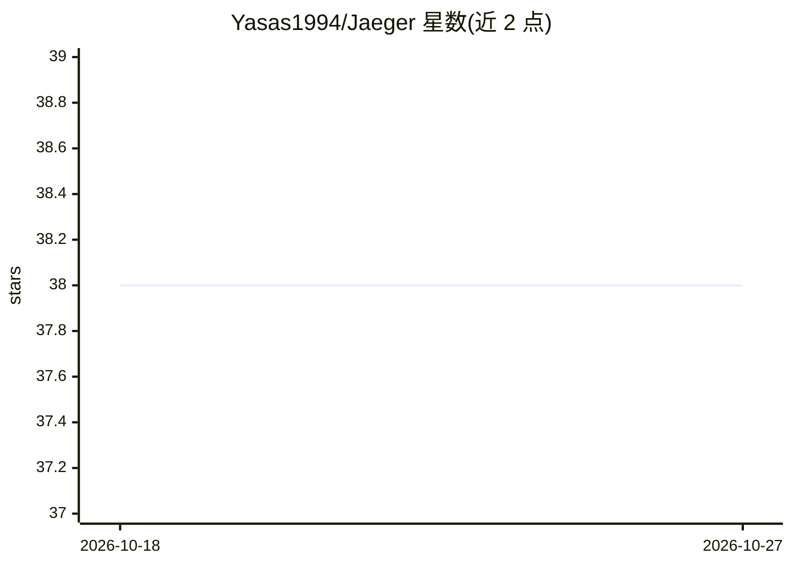

# Yasas1994/Jaeger

⭐ 38 · Python · MIT · 推送 2026-10-14 · [GitHub](https://github.com/Yasas1994/Jaeger) · 个人维护

**宏基因组组装中检测噬菌体与病毒序列的深度学习工具**

免同源比对的深度学习工具，从宏基因组组装结果中识别噬菌体、前噬菌体与真核病毒序列，并将其余 contig 分类为细菌、古菌、质粒或真核宿主，输出每条 contig 的可靠性评分并将分布外序列标记为 uncertain。自 1.26.0 起模型需通过 jaeger download 单独下载，捆绑的 default 模型已弃用并使用旧预测流程。提供安装脚本、bioconda、PyPI、git 源码与 Apptainer 容器多种安装途径，支持 GPU 加速（需 CUDA 与 cuDNN）。

## 筛选速览

| 维度 | 判定 | 备注 |
|---|---|---|
| AI 角色 | `ai-native` | 本体是模型或模型工具 |
| 许可风险 | `permissive` | MIT |
| 部署形态 | `library` | 以包/库形式分发 |
| 模型依赖 | — | README 未给出锁定关系 |
| 硬件要求 | — | 无带数字的原话,不猜 |
| 安装摩擦 | `medium` | 含编译或系统依赖之一 |
| 成熟度 | — | 结构信号不足 |

## 能力要点

- 六类 contig 分类：噬菌体/真核病毒/细菌/古菌/质粒/真核宿主
- 免同源比对（homology-free）的深度学习识别
- 逐 contig 可靠性评分并将分布外序列标记为 uncertain
- 提供一键安装脚本、bioconda、PyPI、git 与 Apptainer 安装方式

## 适用场景

- 从宏基因组组装数据中找出隐藏的病毒基因组序列
- 识别前噬菌体并区分病毒与细菌/质粒等非病毒 contig
- 在集群上用 Apptainer 容器运行病毒检测流程

## 场景标签

 · 领域:生物信息学/宏基因组

## 证据(README 行号)

> L15: Jaeger is a homology-free deep-learning tool that identifies viral genome sequences hidden within metagenomes. It d
> L13: > **Jaeger now detects eukaryotic viruses alongside bacteriophages!** The latest models classify contigs into six g

## 星数曲线

2026-10-18 38 → 2026-10-27 38（+0）

---
*卡片 v1 · prompt 1.4 · 生成 2026-10-25 · 置信度 high · 依据 README sha `c55eb736b806` · [字段定义](../../DATASET.md)*
