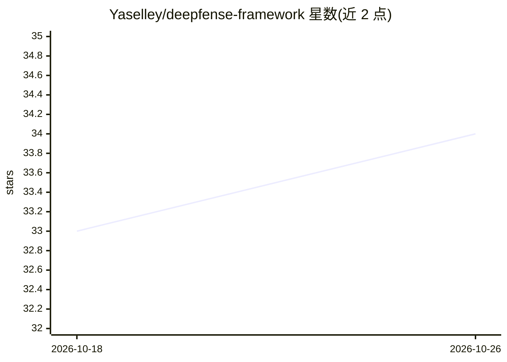

# Yaselley/deepfense-framework

⭐ 34 · Python · Apache-2.0 · 推送 2026-10-22 · [GitHub](https://github.com/Yaselley/deepfense-framework) · [官网](https://deepfense.github.io/) · 组织维护

**模块化深度伪造音频检测框架：YAML 组合前端/后端/损失训练检测器**

面向研究者的 deepfake 音频检测实验框架：通过单一 YAML 配置组合前端特征提取器（Wav2Vec2/WavLM/HuBERT 等 5 种）、后端分类器（AASIST/Nes2Net 等 6 种）、损失函数（4 种）与数据增广（8 种），无需改代码即可跑新实验。master 分支覆盖 clip-level 检测，partial deepfake/PartialSpoof 需切换 deepfense-partial 分支。支持 PyTorch DDP 多卡训练、Parquet 数据输入、注册机制扩展自定义组件，并在 HuggingFace Hub 发布 455+ 预训练模型与 12 个数据集，提供 pip 安装与 CLI。

## 筛选速览

| 维度 | 判定 | 备注 |
|---|---|---|
| AI 角色 | `ai-native` | 本体是模型或模型工具 |
| 许可风险 | `permissive` | Apache-2.0 |
| 部署形态 | `library` | 以包/库形式分发 |
| 模型依赖 | — | README 未给出锁定关系 |
| 硬件要求 | — | 无带数字的原话,不猜 |
| 安装摩擦 | `low` | 无编译、无系统依赖或容器化 |
| 成熟度 | — | 结构信号不足 |

## 能力要点

- YAML 单配置组合 frontend×backend×loss，无需改代码换实验
- 多 GPU 训练：torchrun 启动 PyTorch DDP，检测自动生效
- HuggingFace Hub 发布 455+ 预训练模型与 12 个数据集
- 注册装饰器模式扩展 frontends/backends/losses/augmentations 等组件

## 适用场景

- 组合不同前端与后端做 deepfake 音频检测实验
- 下载预训练模型和数据集直接评估或推理
- 切换 partial deepfake 分支做帧级伪造定位研究

## 场景标签

`模型训练` `网络安全` · 领域:学习与行业

## 证据(README 行号)

> L5: **DeepFense: A Unified, Modular, and Extensible Framework for Robust Deepfake Audio Detection**
> L22: DeepFense lets you build deepfake audio detectors by combining **frontends** (pretrained feature extractors), **bac
> L27: Raw Audio --> Frontend (Wav2Vec2, WavLM, HuBERT, ...) --> Backend (AASIST, MLP, ...) --> Loss --> Score

## 星数曲线

2026-10-18 33 → 2026-10-26 34（+1）

---
*卡片 v1 · prompt 1.4 · 生成 2026-10-25 · 置信度 high · 依据 README sha `b1f5a08c1fe6` · [字段定义](../../DATASET.md)*
