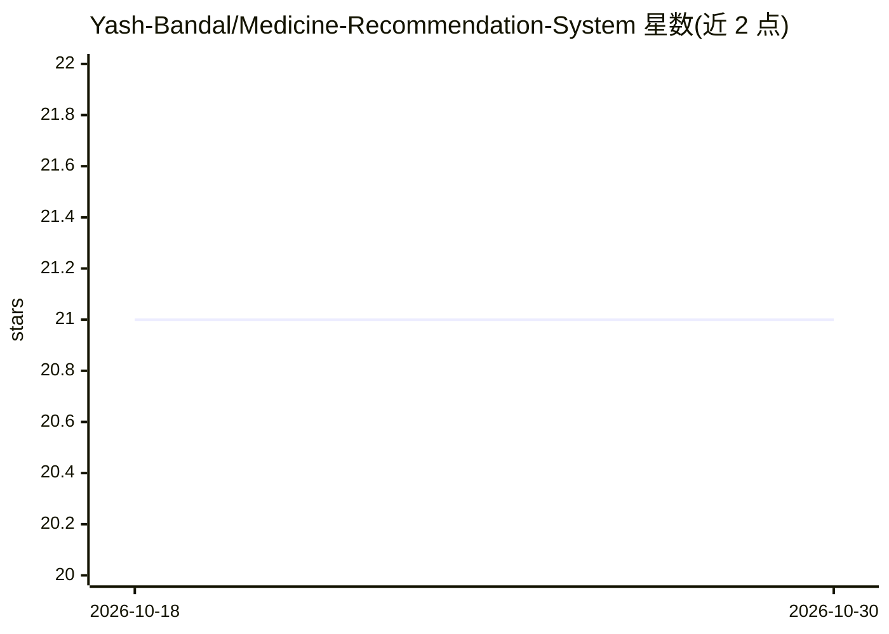

# Yash-Bandal/Medicine-Recommendation-System

⭐ 21 · Jupyter Notebook · MIT · 推送 2026-04-17 · [GitHub](https://github.com/Yash-Bandal/Medicine-Recommendation-System) · [官网](https://wellnessweave.netlify.app) · 个人维护

**基于症状预测疾病并推荐用药/饮食/锻炼的健康仪表盘 Web 应用**

Flask 后端加 React 前端的机器学习 Web 应用：用户输入症状，后端加载 pickle 序列化的多分类模型预测疾病，并从数据集检索对应的药物、饮食、预防措施与锻炼建议，结果呈现在交互式健康仪表盘。训练数据含 57 种疾病、132 种症状，对比了 SVM、Random Forest、Gradient Boosting、KNN、多项朴素贝叶斯五类模型，Random Forest 与多项朴素贝叶斯准确率最高。需本地分别运行 Python 后端与 npm 前端。

## 筛选速览

| 维度 | 判定 | 备注 |
|---|---|---|
| AI 角色 | `ai-native` | 本体是模型或模型工具 |
| 许可风险 | `permissive` | MIT |
| 部署形态 | `library` | 以包/库形式分发 |
| 模型依赖 | — | README 未给出锁定关系 |
| 硬件要求 | — | 无带数字的原话,不猜 |
| 安装摩擦 | `low` | 无编译、无系统依赖或容器化 |
| 成熟度 | — | 结构信号不足 |

## 能力要点

- 症状输入→疾病预测→药物/饮食/预防/锻炼四类推荐
- 覆盖 57 种疾病、132 种症状的多分类任务
- 对比 5 种机器学习模型，Random Forest 达 97.3% 准确率
- Flask + React + Scikit-learn 技术栈，模型以 pickle 部署

## 适用场景

- 根据我输入的症状查看可能的疾病预测
- 获得与预测疾病配套的用药、饮食与锻炼建议
- 学习 Flask+React 的机器学习 Web 应用实现

## 场景标签

 · 领域:医疗健康/机器学习应用

## 证据(README 行号)

> L3: A machine learning powered web application that predicts diseases based on user symptoms and recommends medications,
> L86: 5. The model predicts the most likely disease.

## 星数曲线

2026-10-18 21 → 2026-10-30 21（+0）

---
*卡片 v1 · prompt 1.4 · 生成 2026-10-28 · 置信度 high · 依据 README sha `00ed80b18056` · [字段定义](../../DATASET.md)*
