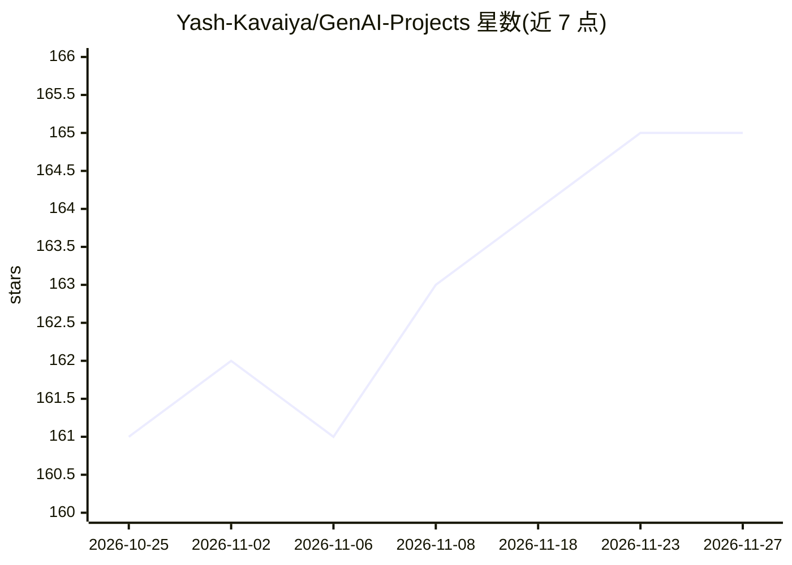

# Yash-Kavaiya/GenAI-Projects

⭐ 165 · 推送 2026-11-24 · [GitHub](https://github.com/Yash-Kavaiya/GenAI-Projects) · 个人维护 · 中文 README

**生成式 AI 与 AI Agent 项目作品集清单，含演示与仓库链接**

个人维护的项目集合页面，以表格形式列出数十个生成式 AI 与 AI Agent 项目，覆盖客服、旅行、HR、法律、医疗、零售、直播等领域；每个条目记录项目描述、技术栈（Google ADK、Dialogflow CX、Gemini、Vertex AI、MCP 等）、Live Demo 链接与仓库/PPT 等资源链接。页面不提供统一安装步骤或运行说明，仅作项目索引与外部链接导航。

## 筛选速览

| 维度 | 判定 | 备注 |
|---|---|---|
| AI 角色 | `ai-knowledge` | 知识聚合/清单类 |
| 许可风险 | `none` | — |
| 部署形态 | `None` |  |
| 模型依赖 | — | README 未给出锁定关系 |
| 硬件要求 | — | 无带数字的原话,不猜 |
| 安装摩擦 | `low` | 无编译、无系统依赖或容器化 |
| 成熟度 | — | 结构信号不足 |

## 能力要点

- 数十个生成式 AI 与 Agent 项目的表格索引
- 每个条目附技术栈、Demo 链接与仓库链接
- 技术栈覆盖 Google ADK、Dialogflow CX、Vertex AI、Gemini、MCP、NVIDIA NeMo 等

## 适用场景

- 查找某个领域的 AI Agent 项目示例及源码入口
- 按 Demo 链接试运行项目的在线版本
- 了解 Google ADK / Dialogflow 等技术栈在各类项目中的组合方式

## 场景标签

`精选清单` · 领域:学习与行业

## 证据(README 行号)

> L3: ## 📊 Projects Overview
> L5: Here's a comprehensive list of my generative AI projects, complete with technologies used and demonstration links.

## 星数曲线

2026-10-25 161 → 2026-11-27 165（+4）

---
*卡片 v1 · prompt 1.4 · 生成 2026-11-27 · 置信度 high · 依据 README sha `171134f9202b` · [字段定义](../../DATASET.md)*
