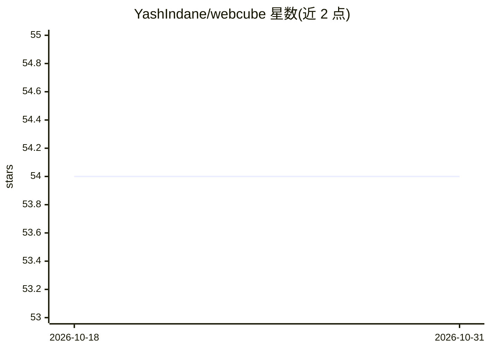

# YashIndane/webcube

⭐ 54 · Python · Apache-2.0 · 推送 2026-05-12 · [GitHub](https://github.com/YashIndane/webcube) · [官网](https://www.linkedin.com/posts/yash-indane-aa6534179_machinelearning-flask-python-activity-6805902901546901507-dN6M) · 个人维护

**魔方求解网页助手：拍照识别六面并语音播报解法**

基于 Flask 的魔方求解 Web 应用：用户按固定顺序拍摄魔方六个面的照片，网页通过表单提交 data_uri 图片，程序用机器学习预测各贴块颜色并生成 cubestring，再调用 Kociemba 两阶段算法计算解法，最后将步骤解码为人类语音指令输出。默认监听 85 端口，浏览器需开启摄像头访问的 chrome flags。提供 Docker/Podman 镜像（含 arm64v8 版本）及 Kubernetes 部署命令。

## 筛选速览

| 维度 | 判定 | 备注 |
|---|---|---|
| AI 角色 | `ai-native` | 本体是模型或模型工具 |
| 许可风险 | `permissive` | Apache-2.0 |
| 部署形态 | `self-host` | docker 或自建部署 |
| 模型依赖 | — | README 未给出锁定关系 |
| 硬件要求 | — | 无带数字的原话,不猜 |
| 安装摩擦 | `low` | 无编译、无系统依赖或容器化 |
| 成熟度 | — | 结构信号不足 |

## 能力要点

- 拍摄六面照片，ML 预测贴块颜色生成 cubestring
- Kociemba 两阶段算法计算魔方解法
- 解法以语音指令输出
- 提供 Docker/Podman 镜像与 Kubernetes 部署命令

## 适用场景

- 不会解魔方时按语音指令一步步还原
- 在树莓派等 arm64 设备上跑本地魔方助手

## 场景标签

`图像视频处理` `语音合成` · 领域:内容生成

## 证据(README 行号)

> L49: Next the function `order` from `order_image.py` renames and creates new images (format example face_0.png to face_5
> L58: The cubestring is passed to the `kociemba.solve()` function, which return a string containing instructions for solv

## 星数曲线

2026-10-18 54 → 2026-10-31 54（+0）

---
*卡片 v1 · prompt 1.4 · 生成 2026-10-24 · 置信度 high · 依据 README sha `96aebbe59000` · [字段定义](../../DATASET.md)*
