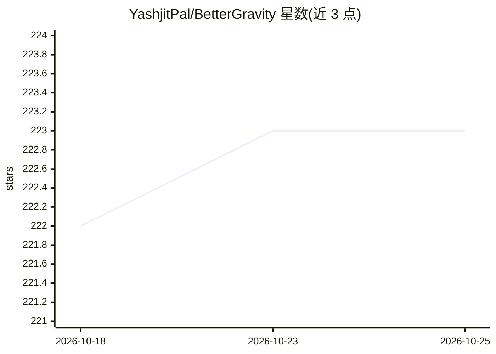

# YashjitPal/BetterGravity

⭐ 223 · JavaScript · NOASSERTION · 推送 2026-10-22 · [GitHub](https://github.com/YashjitPal/BetterGravity) · [官网](https://github.com/YashjitPal/BetterGravity/releases) · 个人维护

**Google Antigravity 的开源社区改造平台：主题、插件与增强功能**

面向 Google Antigravity 2.0 桌面版的修改平台：以运行时注入方式替换 app.asar 引导层，提供 CSS 主题（免构建即时换肤）、纯 JavaScript 插件、界面钩子与插件市场（SHA-256 校验）。内置能力包括重设计的 Gemini 工作区、17+ 桌面宠物（可用 Gemini 生成像素宠物）、应用内浏览器与自主 computer use、自带 Gemini API Key（BYOK）绕过配额、Discord Rich Presence。卸载可逐字节还原原始安装。仅支持 Antigravity 2.x 桌面版，不支持 VS Code 版 Antigravity IDE。

## 筛选速览

| 维度 | 判定 | 备注 |
|---|---|---|
| AI 角色 | `ai-enhanced` | 去掉 AI 部分产品仍成立 |
| 许可风险 | `permissive` | NOASSERTION |
| 部署形态 | `desktop` | 安装包/桌面程序 |
| 模型依赖 | — | README 未给出锁定关系 |
| 硬件要求 | — | 无带数字的原话,不猜 |
| 安装摩擦 | `low` | 无编译、无系统依赖或容器化 |
| 成熟度 | — | 结构信号不足 |

## 能力要点

- CSS 主题与纯 JS 插件的免构建扩展机制
- 自带 Gemini API Key（BYOK）绕过配额并直连自定义 base URL
- 应用内浏览器与 agent 自主 computer use
- 带备份与还原的运行时注入，卸载可逐字节恢复

## 适用场景

- 给 Antigravity 换主题或装插件做个性化扩展
- 用自己的 Gemini API Key 绕过配额限制
- 在 Antigravity 内直接测试网页并让 agent 自主操作浏览器

## 场景标签

`浏览器自动化` · 领域:效率与自动化

## 证据(README 行号)

> L5: **The open community modification platform for Google Antigravity.**
> L25: BetterGravity is both an extensible modification platform and a curated suite of power-user capabilities built dire
> L37: ### 🌐 In-App Browser & Autonomous Computer Use

## 星数曲线

2026-10-18 222 → 2026-10-25 223（+1）

---
*卡片 v1 · prompt 1.4 · 生成 2026-10-22 · 置信度 mid · 依据 README sha `13317fa1a02f` · [字段定义](../../DATASET.md)*
