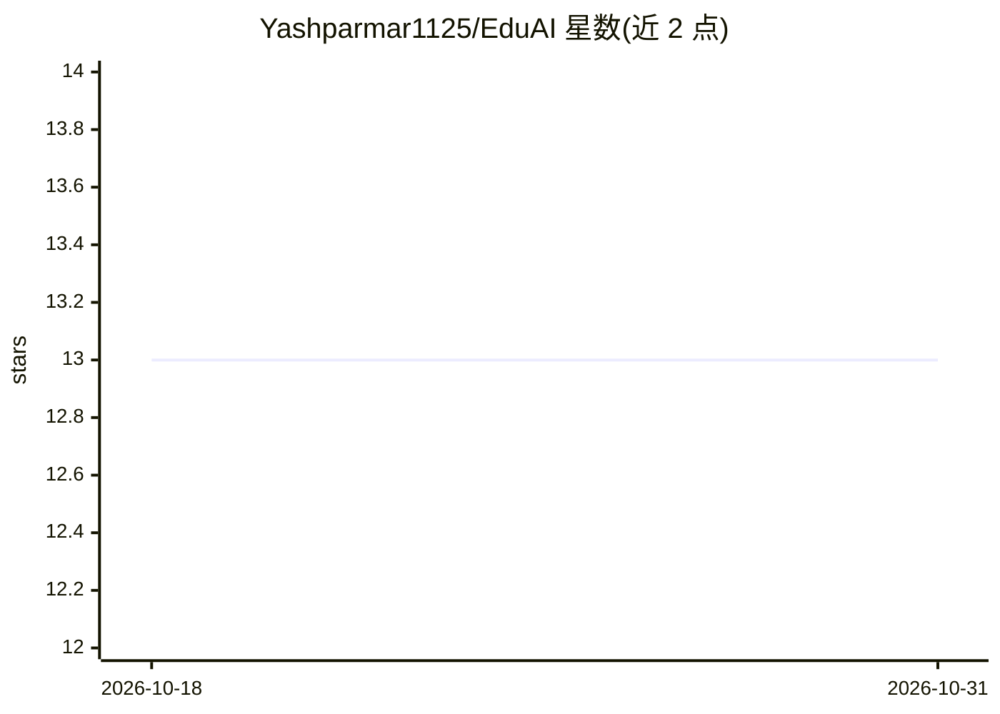

# Yashparmar1125/EduAI

⭐ 13 · JavaScript · 推送 2025-12-31 · [GitHub](https://github.com/Yashparmar1125/EduAI) · [官网](https://eduai-learn.vercel.app/) · 组织维护

**面向学生的 AI 驱动在线学习平台：课程、测评与游戏化**

基于 React/Express/MongoDB/Firebase 的 Web 在线学习平台，提供多媒体课程内容、交互式练习、测评系统与游戏化机制（成就、积分、排行榜）。AI 部分为智能内容推荐、个性化学习路径、自适应难度与表现分析，并有推荐与学习路线图 API 路由。前后端分离部署，需配置 Firebase 与 Cloudinary 账号及环境变量；AI 能力的具体实现机制（模型来源等）在 README 中未说明。

## 筛选速览

| 维度 | 判定 | 备注 |
|---|---|---|
| AI 角色 | `ai-enhanced` | 去掉 AI 部分产品仍成立 |
| 许可风险 | `none` | — |
| 部署形态 | `None` |  |
| 模型依赖 | — | README 未给出锁定关系 |
| 硬件要求 | — | 无带数字的原话,不猜 |
| 安装摩擦 | `low` | 无编译、无系统依赖或容器化 |
| 成熟度 | — | 结构信号不足 |

## 能力要点

- 智能内容推荐与个性化学习路径（/api/recommendations、/api/roadmap）
- 课程、测评、进度跟踪、成就与积分排行榜等游戏化功能
- React 18 + Vite 前端，Express + MongoDB + JWT 后端，前后端分离

## 适用场景

- 搭建带 AI 推荐的在线课程与测评平台
- 通过游戏化机制（积分/成就/排行榜）提升学习参与度
- 跟踪学习进度并生成个性化学习路线图

## 场景标签

 · 领域:教育科技/在线学习

## 证据(README 行号)

> L24: - 🧠 Smart content recommendations
> L132: |🤖 `/api/recommendations`|AI recommendations|

## 星数曲线

2026-10-18 13 → 2026-10-31 13（+0）

---
*卡片 v1 · prompt 1.4 · 生成 2026-10-31 · 置信度 mid · 依据 README sha `0a473d4be6ea` · [字段定义](../../DATASET.md)*
