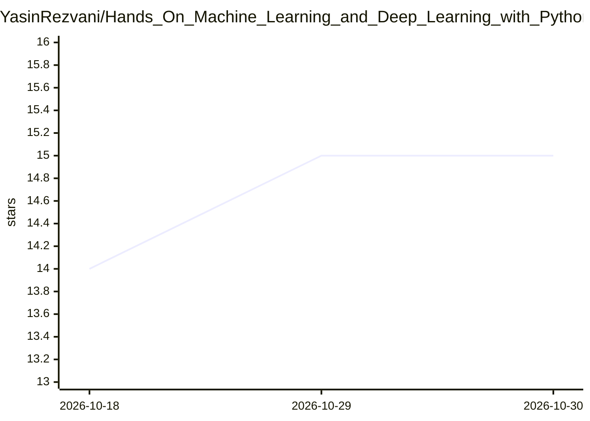

# YasinRezvani/Hands_On_Machine_Learning_and_Deep_Learning_with_Python

⭐ 15 · Jupyter Notebook · MIT · 推送 2026-09-11 · [GitHub](https://github.com/YasinRezvani/Hands_On_Machine_Learning_and_Deep_Learning_with_Python) · 组织维护

**深度学习与计算机视觉的 Python 实操 notebook 教学集**

由 CVLab SHUT（沙赫鲁德理工大学计算机视觉实验室）监督完成的教学型 notebook 集合，面向深度学习与计算机视觉入门：涵盖 NumPy/Pandas/Scipy/Matplotlib/Seaborn 数据分析与可视化练习，以及用 Keras/TensorFlow 和 PyTorch 在 MNIST、CIFAR-10 上训练全连接网络与卷积网络的完整示例。每个 notebook 附带演示视频链接。运行需 Python 3.8+ 与 Jupyter，通过 git clone 克隆仓库并 pip 安装依赖后逐格运行；许可声明为教育用途，使用需注明出处。

## 筛选速览

| 维度 | 判定 | 备注 |
|---|---|---|
| AI 角色 | `ai-knowledge` | 知识聚合/清单类 |
| 许可风险 | `permissive` | MIT |
| 部署形态 | `library` | 以包/库形式分发 |
| 模型依赖 | — | README 未给出锁定关系 |
| 硬件要求 | — | 无带数字的原话,不猜 |
| 安装摩擦 | `low` | 无编译、无系统依赖或容器化 |
| 成熟度 | — | 结构信号不足 |

## 能力要点

- Keras/TensorFlow 与 PyTorch 双框架的 MNIST、CIFAR-10 训练示例
- 覆盖 NumPy/Pandas/Scipy/Matplotlib/Seaborn 的数据处理与可视化练习
- 每个 notebook 附带执行演示视频
- 包含 Keras Sequential 与 Functional API 对比示例

## 适用场景

- 系统练习 Python 数据科学与深度学习基础
- 对照 Keras 与 PyTorch 两种框架实现同一任务
- 学习 MNIST/CIFAR-10 上的模型构建与评估流程

## 场景标签

`教程课程` · 领域:学习与行业

## 证据(README 行号)

> L6: This project was conducted under the supervision of Dr. Mansoor Fateh at CVLab SHUT, focusing on deep learning and c
> L10: Below is a list of all notebooks included in this repository. Each notebook is accompanied by a short demo video sh

## 星数曲线

2026-10-18 14 → 2026-10-30 15（+1）

---
*卡片 v1 · prompt 1.4 · 生成 2026-10-30 · 置信度 high · 依据 README sha `a0a1ba60e888` · [字段定义](../../DATASET.md)*
