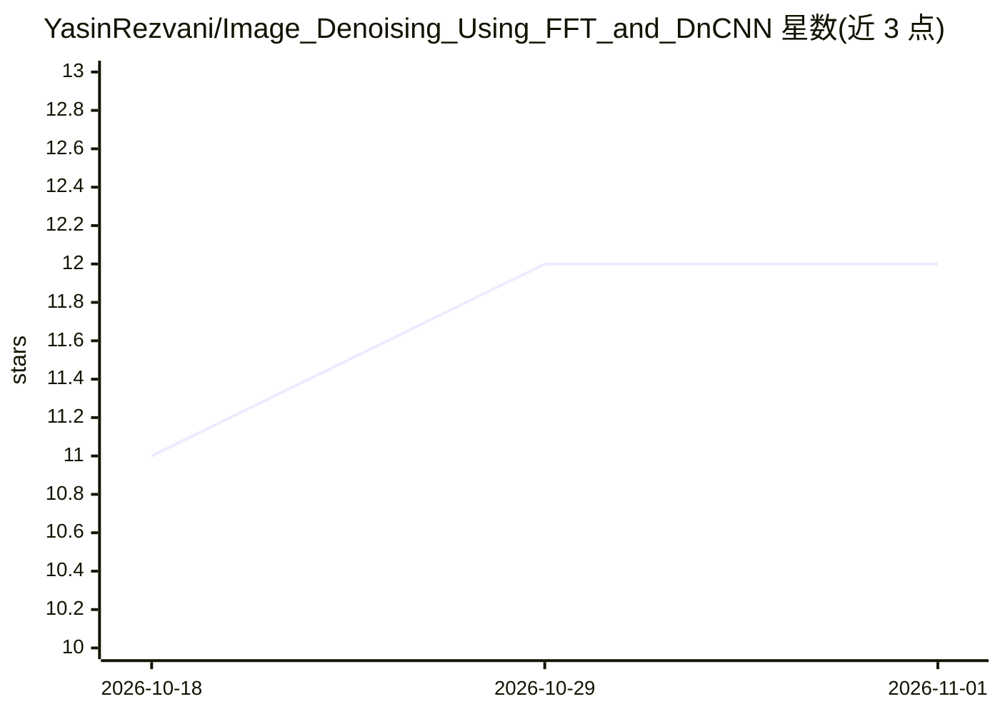

# YasinRezvani/Image_Denoising_Using_FFT_and_DnCNN

⭐ 12 · Jupyter Notebook · MIT · 推送 2026-09-11 · [GitHub](https://github.com/YasinRezvani/Image_Denoising_Using_FFT_and_DnCNN) · 组织维护

**对比 FFT 经典滤波与 DnCNN 深度学习的灰度图像去噪课程项目**

沙鲁德理工大学工程数学课程项目：在加噪灰度图上实现并对比多种去噪方法，包括中值、双边、滑动平均、拉普拉斯等空间域滤波器，FFT 频域低通掩码（固定半径 30 像素）实现的五种滤波器，以及一个 5 层卷积、带批归一化的轻量 DnCNN 残差去噪网络（TensorFlow，训练 5 epochs）。结果以两幅图像并排可视化展示。限制：FFT 滤波共用同一低通掩码，可能不适用于所有滤波类型。

## 筛选速览

| 维度 | 判定 | 备注 |
|---|---|---|
| AI 角色 | `ai-native` | 本体是模型或模型工具 |
| 许可风险 | `permissive` | MIT |
| 部署形态 | `None` |  |
| 模型依赖 | — | README 未给出锁定关系 |
| 硬件要求 | — | 无带数字的原话,不猜 |
| 安装摩擦 | `low` | 无编译、无系统依赖或容器化 |
| 成熟度 | — | 结构信号不足 |

## 能力要点

- 空间域与 FFT 频域共 9 种经典滤波器实现
- 轻量 DnCNN（5 层卷积+批归一化）残差噪声预测
- 结果并排可视化便于方法间对比
- 以 Jupyter Notebook 形式运行

## 适用场景

- 学习和对比经典滤波与深度学习的去噪效果
- 工程数学/数字图像处理课程的参考实现
- 复现并扩展图像去噪实验

## 场景标签

`图像视频处理` `教程课程` · 领域:学习与行业

## 证据(README 行号)

> L8: This project implements and compares various image denoising techniques, ranging from classical spatial and frequenc
> L13: - **Deep learning:** A lightweight Denoising Convolutional Neural Network (DnCNN) trained on synthetic noise.

## 星数曲线

2026-10-18 11 → 2026-11-01 12（+1）

---
*卡片 v1 · prompt 1.4 · 生成 2026-11-01 · 置信度 high · 依据 README sha `32979fe0ece5` · [字段定义](../../DATASET.md)*
