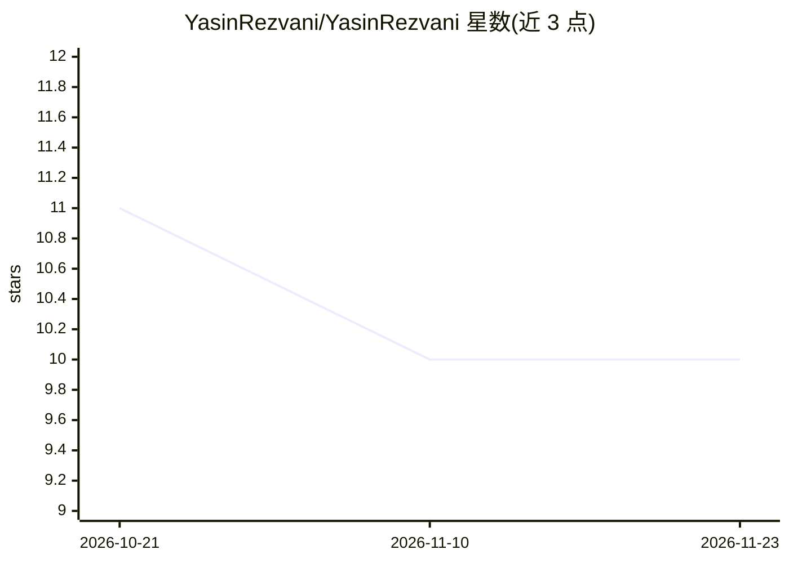

# YasinRezvani/YasinRezvani

⭐ 10 · MIT · 推送 2026-07-16 · [GitHub](https://github.com/YasinRezvani/YasinRezvani) · 个人维护

**AI 研究者 Yasin Rezvani 的 GitHub 个人主页**

该仓库是 GitHub 个人资料主页仓库，内容为研究者 Yasin Rezvani 的自我介绍：列出研究方向包括计算机视觉、医学图像分析、Vision Transformers 与多任务学习，并表达对 AI 技术推动医疗健康的期望。README 主体为 HTML 链接标记与少量文字，不含软件功能、安装说明或可运行代码。维护者位于伊朗（主题标签含 iran）。

## 筛选速览

| 维度 | 判定 | 备注 |
|---|---|---|
| AI 角色 | `ai-knowledge` | 知识聚合/清单类 |
| 许可风险 | `permissive` | MIT |
| 部署形态 | `None` |  |
| 模型依赖 | — | README 未给出锁定关系 |
| 硬件要求 | — | 无带数字的原话,不猜 |
| 安装摩擦 | `low` | 无编译、无系统依赖或容器化 |
| 成熟度 | — | 结构信号不足 |

## 能力要点

- 列出计算机视觉、医学图像分析等研究方向
- 内容为个人主页性质，非软件产品

## 适用场景

- 了解该研究者的研究兴趣
- 访问其 GitHub 主页入口

## 场景标签

 · 领域:个人主页/研究档案

## 证据(README 行号)

> L21: 🧠 Research interests: **Computer Vision**, **Medical Image Analysis**, **Vision Transformers**, and **Multi-Task Le
> L23: 💡 I hope **AI technologies** continue to advance **healthcare** and improve **people's quality of life**.

## 星数曲线

2026-10-21 11 → 2026-11-23 10（-1）

---
*卡片 v1 · prompt 1.4 · 生成 2026-11-20 · 置信度 high · 依据 README sha `649d01409188` · [字段定义](../../DATASET.md)*
