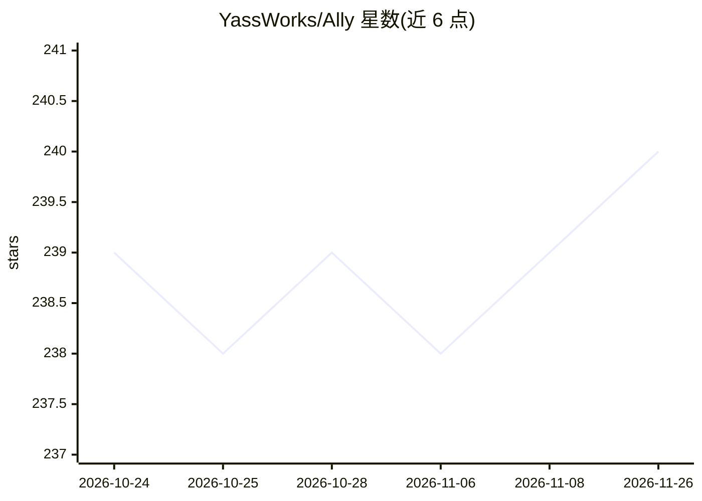

# YassWorks/Ally

⭐ 240 · Python · Apache-2.0 · 推送 2026-11-18 · [GitHub](https://github.com/YassWorks/Ally) · [官网](https://hub.docker.com/r/yassw0rks/ally) · 个人维护

**终端里的本地优先、多服务商 AI 代理 CLI**

命令行 AI 代理，提供聊天、文件读写、执行 shell 命令、网页搜索与本地文档问答等能力；每个工具调用需用户批准（可放宽）。支持通过 Ollama 完全本地运行，或接入 OpenAI、Anthropic、Google Gemini、Groq、Cerebras、OpenRouter，且每个 agent 可配置不同服务商。内置基于 Chroma 的本地 RAG，可嵌入文本/Markdown/PDF/DOCX 文件并引用来源；会话按 ID 保存可恢复，支持 Docker 运行与管道输入脚本化使用。

## 筛选速览

| 维度 | 判定 | 备注 |
|---|---|---|
| AI 角色 | `ai-native` | 本体是模型或模型工具 |
| 许可风险 | `permissive` | Apache-2.0 |
| 部署形态 | `None` |  |
| 模型依赖 | local-ok | 支持本地模型 |
| 硬件要求 | — | 无带数字的原话,不猜 |
| 安装摩擦 | `low` | 无编译、无系统依赖或容器化 |
| 成熟度 | — | 结构信号不足 |

## 能力要点

- 文件、shell、Python、git、代码搜索与网页工具，调用需批准
- 本地 RAG：嵌入文件夹到 Chroma 并带文件引用回答
- 每个 agent 可在单一配置文件中指定 provider 与模型，聊天中 /model 切换
- 会话本地持久化，支持按 ID 恢复；支持管道输入脚本调用

## 适用场景

- 在终端里让 AI 读写文件并执行命令完成开发任务
- 对本地文档/PDF 建知识库做带引用的问答
- 通过 Ollama 完全离线使用代理，保护隐私
- 用 --allow-all-tools 与管道把代理接入脚本流程

## 场景标签

`编码 Agent` `文档问答` · 领域:编码与开发

## 证据(README 行号)

> L9: **A private, provider-agnostic AI agent for your terminal.**
> L11: Ally is a command line agent that chats with you, reads and edits your files, runs commands, searches the web and a
> L16: - **Local RAG.** Embed folders of text, Markdown, PDF and DOCX files into a local Chroma database and chat with the

## 星数曲线

2026-10-24 239 → 2026-11-26 240（+1）

---
*卡片 v1 · prompt 1.4 · 生成 2026-11-25 · 置信度 high · 依据 README sha `bb3defaa8e9f` · [字段定义](../../DATASET.md)*
