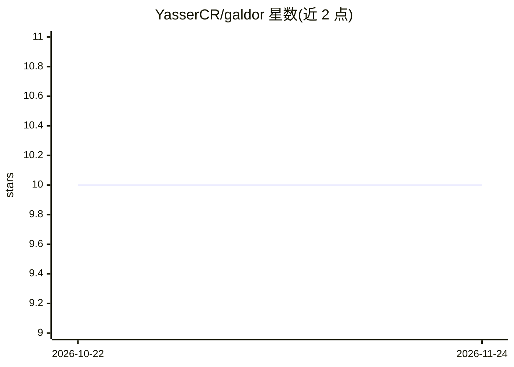

# YasserCR/galdor

⭐ 10 · Go · Apache-2.0 · 推送 2026-09-30 · [GitHub](https://github.com/YasserCR/galdor) · [官网](https://galdor.org) · 个人维护

**Go 原生 LLM Agent 框架：构建编排与内置观测**

面向 Go 开发者的 LLM Agent 框架，覆盖构建、编排与观测三环节。核心机制：基于反射生成 JSON Schema 的类型安全工具、带检查点与中断恢复的有向图运行时、ReAct 与 Plan-and-Execute 助手、Supervisor/Swarm 多智能体模式、MCP/A2A 双协议一等方式支持、内嵌 SQLite 的 OTel 观测与同二进制分发的 Web 仪表盘。v1.0.0 起 pkg/ 下公共 API 按 SemVer 承诺稳定，依赖按模块拆分以控制依赖树规模。

## 筛选速览

| 维度 | 判定 | 备注 |
|---|---|---|
| AI 角色 | `ai-ecosystem` | LLM/agent 周边工具 |
| 许可风险 | `permissive` | Apache-2.0 |
| 部署形态 | `library` | 以包/库形式分发 |
| 模型依赖 | local-ok | 支持本地模型 |
| 硬件要求 | — | 无带数字的原话,不猜 |
| 安装摩擦 | `low` | 无编译、无系统依赖或容器化 |
| 成熟度 | — | 结构信号不足 |

## 能力要点

- OTel 原生观测：内嵌 SQLite 追踪存储与单二进制自托管仪表盘
- 第一方 MCP client+server 与 A2A 协议支持（stdio/SSE/Streamable HTTP）
- 类型安全工具与 schema 绑定的结构化输出（Go struct 进、解码值出）
- 确定性回放：录制真实运行导出为 fixture，离线回归测试不消耗 token

## 适用场景

- 在 Go 技术栈中构建需要人工审批环节的 Agent 工作流
- 将自有工具通过 MCP server 暴露给 Claude Desktop
- 用录制回放为 prompt 与 Agent 编写不联网的回归测试
- 自托管追踪与仪表盘，替代外部 SaaS 观测服务

## 场景标签

`Agent 框架` `多智能体` `LLM 可观测性` · 领域:Agent 开发

## 证据(README 行号)

> L5: **A Go-native framework for building, orchestrating and observing AI agents.**
> L30: galdor's distinctive position: **OTel-native + a single-binary self-hosted dashboard + first-party MCP server + fir
> L40: The 10-phase roadmap is functionally complete: provider abstraction (Anthropic, OpenAI/MiniMax/Groq/Together/DeepSe

## 星数曲线

2026-10-22 10 → 2026-11-24 10（+0）

---
*卡片 v1 · prompt 1.4 · 生成 2026-11-20 · 置信度 high · 依据 README sha `b3457ff2619b` · [字段定义](../../DATASET.md)*
