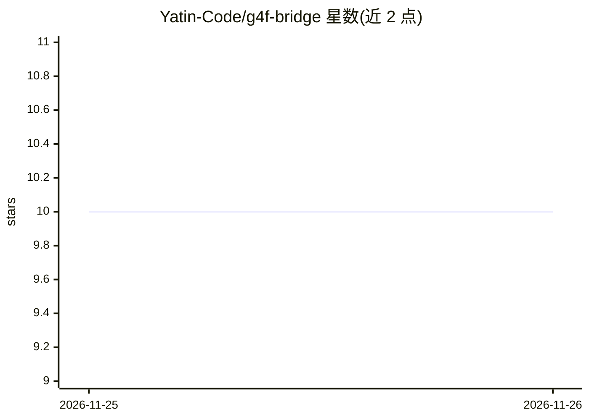

# Yatin-Code/g4f-bridge

⭐ 10 · Python · NOASSERTION · 推送 2026-08-11 · [GitHub](https://github.com/Yatin-Code/g4f-bridge) · 个人维护

**本地桥接服务：让 AI 编码工具接入 G4F/EAON 免费模型**

基于 FastAPI 的本地代理桥接服务，监听 1337 端口，在 OpenAI Chat 与 Anthropic Messages 两种 API 格式间做翻译，净化 SSE 流后返回响应。面向使用 OpenCode、Claude Code、Codex CLI 等编码工具的用户，通过修改各工具的配置文件将其模型请求转发到 G4F/EAON 代理。提供 TUI（设置向导、模型选择、实时日志仪表盘）与 CLI（列出模型、自动选取模型）。支持自定义 provider key，跨 Linux/macOS/Windows 平台。Cursor 与 Antigravity 集成标注为开发中。

## 筛选速览

| 维度 | 判定 | 备注 |
|---|---|---|
| AI 角色 | `ai-ecosystem` | LLM/agent 周边工具 |
| 许可风险 | `none` | NOASSERTION |
| 部署形态 | `library` | 以包/库形式分发 |
| 模型依赖 | — | README 未给出锁定关系 |
| 硬件要求 | — | 无带数字的原话,不猜 |
| 安装摩擦 | `low` | 无编译、无系统依赖或容器化 |
| 成熟度 | — | 结构信号不足 |

## 能力要点

- 提供 OpenAI 与 Anthropic 两种 API 格式端点并做格式互译
- TUI 向导与实时日志仪表盘，CLI 可列出/选取模型
- 修改各编码工具配置文件完成接入
- 支持通过 keys.json 添加自定义 provider

## 适用场景

- 让 Claude Code 通过 Anthropic Messages 端点调用其他模型
- 在 OpenCode/Codex CLI 中切换多个模型来源
- 用模型发现端点查看可用模型列表

## 场景标签

`模型网关` · 领域:Agent 开发

## 证据(README 行号)

> L53: Your Tool ──► g4f-bridge:1337 ──► G4F / EAON
> L55:                ├── Translates Anthropic ⇄ OpenAI
> L63: |`POST /v1/messages`|Anthropic Messages|Claude Code|

## 星数曲线

2026-11-25 10 → 2026-11-26 10（+0）

---
*卡片 v1 · prompt 1.4 · 生成 2026-11-24 · 置信度 high · 依据 README sha `cf13712e5a45` · [字段定义](../../DATASET.md)*
