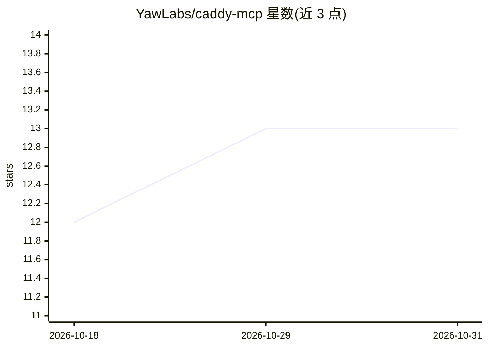

# YawLabs/caddy-mcp

⭐ 13 · TypeScript · MIT · 推送 2026-10-27 · [GitHub](https://github.com/YawLabs/caddy-mcp) · [官网](https://yaw.sh/mcp-servers/caddy-mcp/) · 组织维护

**通过 MCP 客户端管理 Caddy Web 服务器的 MCP 服务器**

Yaw Labs 开发的 Caddy admin API MCP server，供 Claude Code、Cursor 等 MCP 客户端调用：提供 18 个工具与 4 个资源，覆盖 Caddy admin API 全部端点——配置读写、路由、反向代理、TLS、PKI、指标与快照。写入操作使用 ETag（If-Match）防并发覆盖，配置根写入需 confirm 并先做快照，工具声明 readOnly/destructive/idempotent 注解。以 npm 单包发布，仅两个运行时依赖，支持 oam 运行时与沙箱模式；通过环境变量配置 admin 地址、超时与重试策略。

## 筛选速览

| 维度 | 判定 | 备注 |
|---|---|---|
| AI 角色 | `ai-ecosystem` | LLM/agent 周边工具 |
| 许可风险 | `permissive` | MIT |
| 部署形态 | `library` | 以包/库形式分发 |
| 模型依赖 | — | README 未给出锁定关系 |
| 硬件要求 | — | 无带数字的原话,不猜 |
| 安装摩擦 | `low` | 无编译、无系统依赖或容器化 |
| 成熟度 | — | 结构信号不足 |

## 能力要点

- 18 工具 + 4 资源覆盖 Caddy admin API 全部端点
- ETag（If-Match）并发写入保护，412 以明确消息呈现
- 配置根写入需 confirm=true 且自动快照，可用 caddy_revert 恢复
- 支持 unix socket admin 端点与 oam 沙箱（网络/文件系统受限）

## 适用场景

- 让 Claude Code/Cursor 等 MCP 客户端直接配置和管理 Caddy 服务器
- 用自然语言添加反向代理、查询路由或查看 Prometheus 指标
- 对 Caddy 配置做带快照回滚的安全变更

## 场景标签

 · 领域:Web 服务器运维/开发工具

## 证据(README 行号)

> L11: **Manage Caddy web servers from Claude Code, Cursor, and any MCP client.** 18 tools + 4 resources covering every en
> L126: ## Tools

## 星数曲线

2026-10-18 12 → 2026-10-31 13（+1）

---
*卡片 v1 · prompt 1.4 · 生成 2026-10-31 · 置信度 high · 依据 README sha `bef894a36f21` · [字段定义](../../DATASET.md)*
