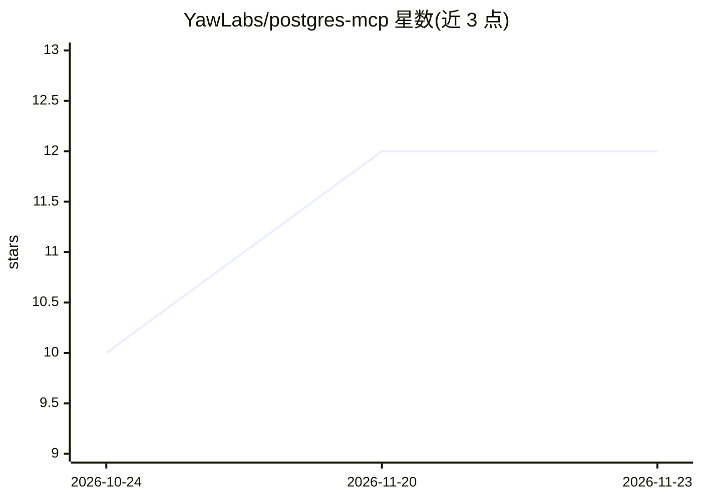

# YawLabs/postgres-mcp

⭐ 12 · TypeScript · MIT · 推送 2026-11-21 · [GitHub](https://github.com/YawLabs/postgres-mcp) · [官网](https://yaw.sh/mcp-servers/postgres-mcp/) · 组织维护

**面向 AI agent 的 PostgreSQL MCP 服务器：查询、检查、诊断数据库**

以 npm 包形式分发的 PostgreSQL MCP 服务器，默认只读、通过环境变量选择性开放写入，供 Claude Code、Cursor 等任意 MCP 客户端调用。提供 schema 内省、参数化查询、EXPLAIN 计划、慢查询/未用索引/表膨胀诊断、健康快照、角色权限查看等工具；pg_query 用扩展查询协议限制单语句以阻断堆叠注入，推荐用最小权限角色作为主访问控制。背景：替代 Anthropic 已归档的参考实现。Node 22 为最低版本。

## 筛选速览

| 维度 | 判定 | 备注 |
|---|---|---|
| AI 角色 | `ai-ecosystem` | LLM/agent 周边工具 |
| 许可风险 | `permissive` | MIT |
| 部署形态 | `desktop` | 安装包/桌面程序 |
| 模型依赖 | — | README 未给出锁定关系 |
| 硬件要求 | — | 无带数字的原话,不猜 |
| 安装摩擦 | `low` | 无编译、无系统依赖或容器化 |
| 成熟度 | — | 结构信号不足 |

## 能力要点

- 默认只读：pg_query 在 BEGIN READ ONLY 事务中运行，写入需 ALLOW_WRITES=1
- pg_index_advisor 基于 HypoPG 假想索引推荐索引，不落盘
- pg_top_queries/pg_seq_scan_tables/pg_table_bloat/pg_health 等性能诊断工具
- 扩展查询协议限制单语句，阻断堆叠查询注入

## 适用场景

- 让 Claude Code/Cursor 中的 agent 查询和内省 PostgreSQL 数据库
- 排查慢查询：EXPLAIN ANALYZE、top queries、未用索引分析
- 用最小权限角色安全地把数据库接入 AI agent
- 在不开放写入的前提下做性能健康巡检

## 场景标签

 · 领域:数据库/开发工具

## 证据(README 行号)

> L10: **Query a PostgreSQL database from Claude Code, Cursor, and any MCP client.** Read-only by default - writes opt in 
> L50: - **Perf diagnostics the deprecated server never had** - `pg_top_queries` (from `pg_stat_statements`), `pg_seq_scan

## 星数曲线

2026-10-24 10 → 2026-11-23 12（+2）

---
*卡片 v1 · prompt 1.4 · 生成 2026-11-20 · 置信度 high · 依据 README sha `98e3ff994ab7` · [字段定义](../../DATASET.md)*
