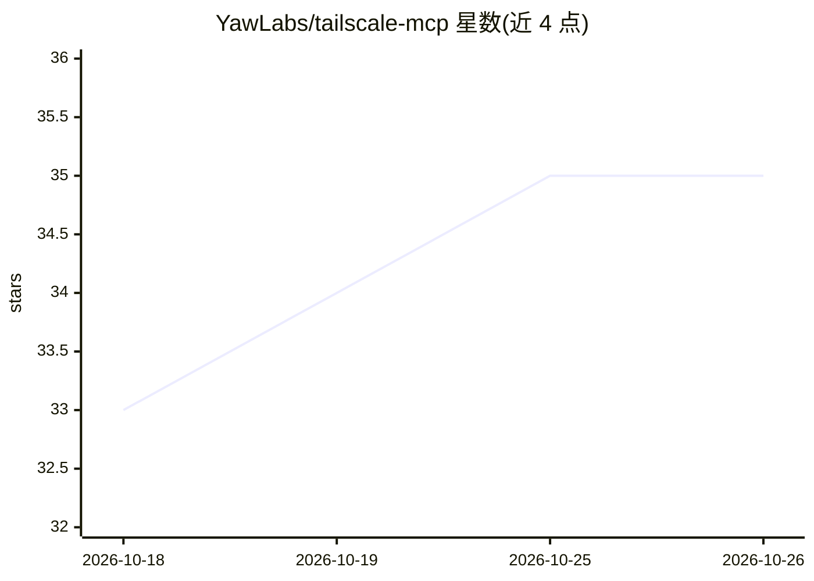

# YawLabs/tailscale-mcp

⭐ 35 · TypeScript · MIT · 推送 2026-10-22 · [GitHub](https://github.com/YawLabs/tailscale-mcp) · [官网](https://yaw.sh/mcp-servers/tailscale-mcp/) · 组织维护

**让 AI 助手通过 MCP 管理 Tailscale tailnet 的服务器**

由 Yaw Labs 维护的 MCP server，将 Tailscale v2 管理 API 封装为 97 个类型化工具加 6 个可选本地 CLI 诊断工具，覆盖设备、ACL、DNS、密钥、用户、webhook、审计日志等，供 Claude Code、Cursor 等 MCP 客户端中的 agent 调用。提供 profile/工具组/只读/写域四层工具裁剪机制，写操作带 destructiveHint/idempotentHint 标注供客户端门控。经 npx 安装，需配置 Tailscale API key；附 1900+ 单元测试。

## 筛选速览

| 维度 | 判定 | 备注 |
|---|---|---|
| AI 角色 | `ai-ecosystem` | LLM/agent 周边工具 |
| 许可风险 | `permissive` | MIT |
| 部署形态 | `desktop` | 安装包/桌面程序 |
| 模型依赖 | — | README 未给出锁定关系 |
| 硬件要求 | — | 无带数字的原话,不猜 |
| 安装摩擦 | `low` | 无编译、无系统依赖或容器化 |
| 成熟度 | — | 结构信号不足 |

## 能力要点

- 97 个管理 API 工具 + 6 个本地 CLI 诊断工具，覆盖 Tailscale v2 API
- TAILSCALE_PROFILE / TOOLS / READONLY / WRITE_GROUPS 四层工具裁剪与写域门控
- 常驻 tailscale_tool_groups 工具让 agent 区分工具未加载与被禁用
- 1900+ 单元测试覆盖每个工具的输入校验与错误处理

## 适用场景

- 用对话让 agent 查询设备、ACL 变更审计并执行密钥轮换等运维操作
- 在 MCP 客户端中按只读或限定写域方式安全接入 tailnet 管理
- 让 agent 起草并校验 ACL 变更 diff

## 场景标签

 · 领域:网络运维/Agent 工具服务

## 证据(README 行号)

> L12: **Ask your agent questions about your tailnet and have it act on the answers.** 97 admin-API tools + 6 optional loc
> L36: - **Cross-client, and updates arrive as a version bump.** An MCP server works in Claude Code, Claude Desktop, Curso

## 星数曲线

2026-10-18 33 → 2026-10-26 35（+2）

---
*卡片 v1 · prompt 1.4 · 生成 2026-10-25 · 置信度 high · 依据 README sha `61089645c645` · [字段定义](../../DATASET.md)*
