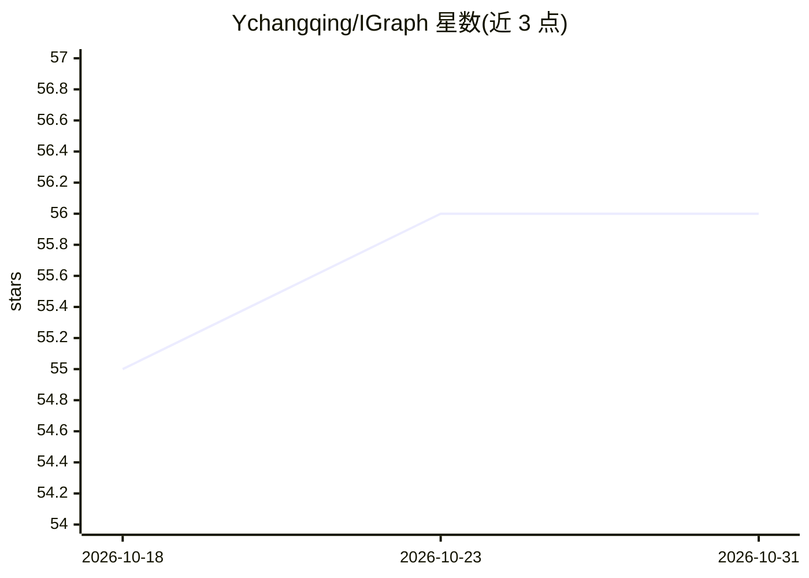

# Ychangqing/IGraph

⭐ 56 · TypeScript · 推送 2026-08-12 · [GitHub](https://github.com/Ychangqing/IGraph) · [官网](https://ychangqing.github.io/IGraph/) · 个人维护 · 中文 README

**把代码仓库构建为知识图谱的 CLI 工具，可接入 AI 助手**

命令行工具 igraph-cli：用 tree-sitter 将 TypeScript/JavaScript/Python/Go/Java 仓库解析为符号节点与调用关系边，LLM 生成语义摘要（无 API Key 时启发式降级），BGE-M3 向量与 FTS5 全文经 RRF 融合检索；支持挂载 PRD 文档、DB Schema 建立跨模态关联，SHA-256 diff 增量构建。内置 MCP Server，一条命令注册到 Cursor / Claude Code，暴露 4 个只读检索 Tool；另有 Web 可视化面板。安装需 Node.js >= 18 与 C/C++ 构建工具链。

## 筛选速览

| 维度 | 判定 | 备注 |
|---|---|---|
| AI 角色 | `ai-ecosystem` | LLM/agent 周边工具 |
| 许可风险 | `none` | — |
| 部署形态 | `library` | 以包/库形式分发 |
| 模型依赖 | — | README 未给出锁定关系 |
| 硬件要求 | — | 无带数字的原话,不猜 |
| 安装摩擦 | `medium` | 含编译或系统依赖之一 |
| 成熟度 | — | 结构信号不足 |

## 能力要点

- tree-sitter 5-Pass 流水线解析 5 种语言为知识图谱
- Dense（BGE-M3）+ FTS5 双通道 RRF 融合检索
- MCP Server 一条命令接入 Cursor / Claude Code，4 个只读检索 Tool
- PRD / DB Schema 多模态挂载与 SHA-256 增量构建

## 适用场景

- 为 AI 编程助手提供带调用关系上下文的代码检索
- 在浏览器中浏览代码图谱结构与模拟自然语言检索
- 把 PRD 与 DB Schema 和代码符号建立关联后统一查询

## 场景标签

`知识图谱` · 领域:知识与检索

## 证据(README 行号)

> L22: IGraph 把代码仓库解析为「符号节点 + 调用关系边」的知识图谱，叠加 LLM 语义摘要与向量索引，通过双通道（Dense + FTS5）RRF 融合检索对外服务。支持挂载 PRD / DB Schema 等多模态资源建立跨模
> L34: |🤖 MCP 集成|一条命令接入 Cursor / Claude Code|
> L76: 注册后 AI 助手可直接调用 4 个只读检索 Tool：

## 星数曲线

2026-10-18 55 → 2026-10-31 56（+1）

---
*卡片 v1 · prompt 1.4 · 生成 2026-10-24 · 置信度 high · 依据 README sha `dabd7b0e9565` · [字段定义](../../DATASET.md)*
