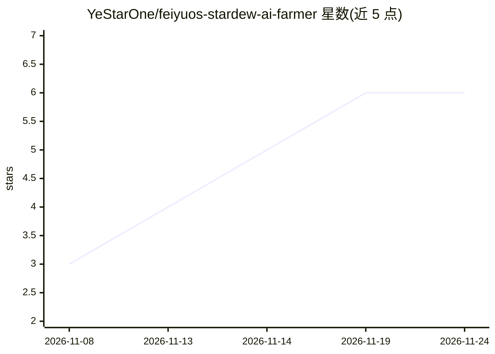

# YeStarOne/feiyuos-stardew-ai-farmer

⭐ 6 · JavaScript · MIT · 推送 2026-11-22 · [GitHub](https://github.com/YeStarOne/feiyuos-stardew-ai-farmer) · 个人维护 · 中文 README

**让 AI Agent 自主游玩星露谷物语的脚本与 mod 工程**

作者公开的实验工程：通过 SMAPI mod（自研 BehaviorBridge/FeiyuAutoLoad）把游戏状态与操作暴露成 HTTP 端点，再用 Node.js 脚本驱动 AI Agent 完成种地、浇水、钓鱼、挖矿、卖货、睡觉存档的日循环，并附带任务队列、无人值守守卫、技能卡沉淀机制与 28 份攻略文档。运行依赖星露谷 1.6.x、SMAPI、NagiBridge、行为学 mod 与 Node.js ≥18；README 中 AI 调用的模型供应商未具名。

## 筛选速览

| 维度 | 判定 | 备注 |
|---|---|---|
| AI 角色 | `ai-native` | 本体是模型或模型工具 |
| 许可风险 | `permissive` | MIT |
| 部署形态 | `None` |  |
| 模型依赖 | — | README 未给出锁定关系 |
| 硬件要求 | — | 无带数字的原话,不猜 |
| 安装摩擦 | `medium` | 含编译或系统依赖之一 |
| 成熟度 | — | 结构信号不足 |

## 能力要点

- 自研 SMAPI mod（BehaviorBridge/FeiyuAutoLoad）将游戏操作暴露为 HTTP 端点
- day-loop 日循环脚本实现收菜/浇水/补种/卖货/钓鱼/睡觉存档
- 游戏调用离线提炼为技能卡（SKILL.md）热载复用
- 175 个 NagiBridge 端点实测并整理为全表文档

## 适用场景

- 让 AI Agent 自动经营我的星露谷存档
- 改造这套 HTTP 桥脚本做自己的游戏自动化
- 参考踩坑笔记给其他游戏写 AI 操作桥

## 场景标签

 · 领域:游戏/自动化

## 证据(README 行号)

> L3: > 一个 AI Agent 从零接管《星露谷物语》存档的实验工程：**它自己种地、浇水、钓鱼、卖货、睡觉存档，连续跑了几十个游戏日。**
> L185: - Stardew Valley 1.6.x + SMAPI 4.x
> L195: 4. `node day-loop.mjs` —— AI 开始种田。

## 星数曲线

2026-11-08 3 → 2026-11-24 6（+3）

---
*卡片 v1 · prompt 1.4 · 生成 2026-11-20 · 置信度 high · 依据 README sha `25dd0f4d7696` · [字段定义](../../DATASET.md)*
