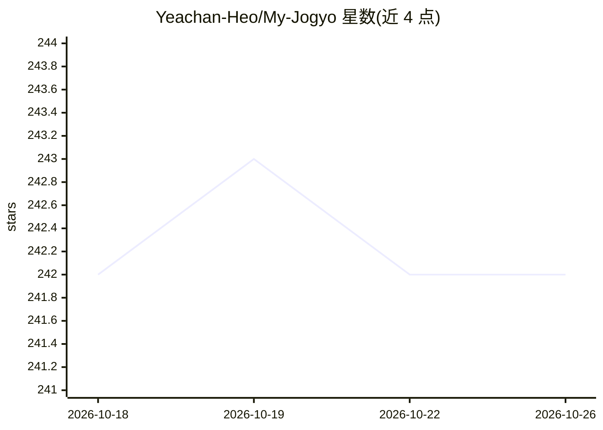

# Yeachan-Heo/My-Jogyo

⭐ 242 · TypeScript · 推送 2026-02-21 · [GitHub](https://github.com/Yeachan-Heo/My-Jogyo) · 个人维护 · 中文 README

**OpenCode/Claude Code 的科研自动化插件：多 agent 协作生成可复现 notebook**

面向 OpenCode 与 Claude Code 的研究自动化系统，以四个 agent 角色分工：Gyoshu 负责规划与编排，Jogyo 通过持久化 Python REPL 执行实验，Baksa 以对抗方式核验声明并计算信任分，Paper Writer 将标记化产出转为叙述性报告。研究过程自动生成可复现的 .ipynb，支持交互/自主/REPL 三种模式；发现须附置信区间与效应量等统计标记方可通过质量门。通过 MCP 服务器、OpenCode 插件（npm 分发）或 CLI 安装；要求 Python 3.10+、Node.js 18+，Windows 仅支持 WSL2。

## 筛选速览

| 维度 | 判定 | 备注 |
|---|---|---|
| AI 角色 | `ai-ecosystem` | LLM/agent 周边工具 |
| 许可风险 | `none` | — |
| 部署形态 | `library` | 以包/库形式分发 |
| 模型依赖 | locked-api |  |
| 硬件要求 | — | 无带数字的原话,不猜 |
| 安装摩擦 | `low` | 无编译、无系统依赖或容器化 |
| 成熟度 | — | 结构信号不足 |

## 能力要点

- 四个 agent 角色分工：规划、执行、对抗核验、报告撰写
- 持久化 Python REPL 与自动生成可复现 .ipynb
- [OBJECTIVE]/[HYPOTHESIS]/[FINDING] 等结构化标记组织研究输出
- 信任分质量门：发现须含置信区间与效应量，低于阈值降级为探索性观察

## 适用场景

- 设定研究目标后让 agent 自主完成 EDA、建模与报告
- 在 OpenCode/Claude Code 中以对话方式做交互式数据分析
- 把实验过程自动沉淀为带统计证据的可复现 notebook

## 场景标签

`多智能体` `科研工具` `数据分析` · 领域:Agent 开发

## 证据(README 行号)

> L9: Together, they form an end-to-end research automation system for OpenCode that turns your research goals into reprod
> L41: ### Option 1: Claude Code (MCP Server)

## 星数曲线

2026-10-18 242 → 2026-10-26 242（+0）

---
*卡片 v1 · prompt 1.4 · 生成 2026-10-22 · 置信度 mid · 依据 README sha `a3274df954f7` · [字段定义](../../DATASET.md)*
