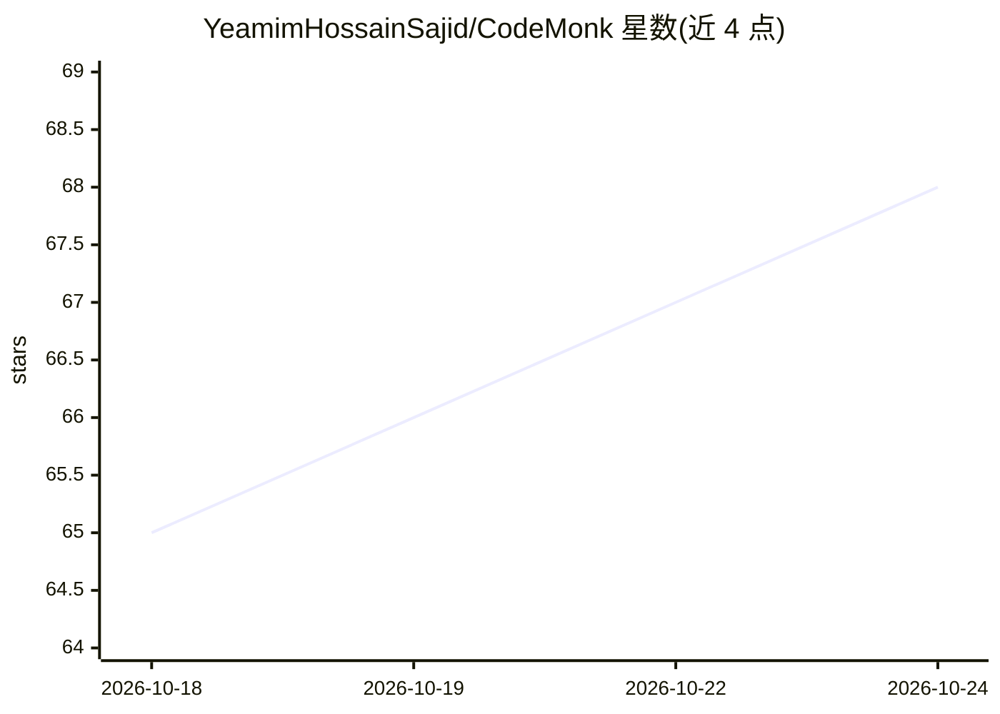

# YeamimHossainSajid/CodeMonk

⭐ 68 · Java · 推送 2026-10-23 · [GitHub](https://github.com/YeamimHossainSajid/CodeMonk) · 个人维护

**帮开发者理解复杂代码库的开源 AI 代码智能平台**

基于 Spring Boot 3、Spring Cloud 与 Kafka 构建的代码智能平台：通过 AST/Tree-Sitter 解析 Java、Kotlin、TypeScript、Go，将调用图、数据流与跨服务依赖建模进 Neo4j 知识图谱，结合 pgvector/Qdrant 的向量与词法混合检索，以 Spring AI 多智能体支持架构级问答与影响分析。当前核心骨架与基础文件摄取已可用，AST 解析、向量索引、知识图谱与 Agent 编排等仍在进行或规划中；本地开发通过 Docker Compose 启动基础设施后用 Maven 构建。

## 筛选速览

| 维度 | 判定 | 备注 |
|---|---|---|
| AI 角色 | `ai-native` | 本体是模型或模型工具 |
| 许可风险 | `none` | — |
| 部署形态 | `self-host` | docker 或自建部署 |
| 模型依赖 | — | README 未给出锁定关系 |
| 硬件要求 | — | 无带数字的原话,不猜 |
| 安装摩擦 | `low` | 无编译、无系统依赖或容器化 |
| 成熟度 | `idea` | |

## 能力要点

- Tree-Sitter AST 解析提取调用图与跨服务关系（规划/进行中）
- Neo4j 知识图谱 + pgvector/Qdrant 混合 RAG 检索
- Spring AI 多智能体编排支持仓库级问答（规划中）
- 事件驱动微服务架构：Spring Cloud、Apache Kafka

## 适用场景

- 接手新仓库或遗留系统时以问答方式理解架构与调用链
- 改动函数签名前分析潜在受影响组件
- 参与分布式系统与 AI 工程的开源贡献实践

## 场景标签

`知识图谱` `RAG` · 领域:知识与检索

## 证据(README 行号)

> L3: > An open-source AI-powered platform for understanding complex codebases.
> L24: CodeMonk bridges raw code parsing with state-of-the-art AI reasoning. Rather than relying solely on naive keyword m
> L33: By connecting static code analysis with graph representations and large language models, CodeMonk allows developers

## 星数曲线

2026-10-18 65 → 2026-10-24 68（+3）

---
*卡片 v1 · prompt 1.4 · 生成 2026-10-24 · 置信度 mid · 依据 README sha `f9c3de2615ac` · [字段定义](../../DATASET.md)*
